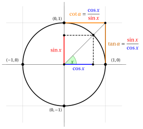
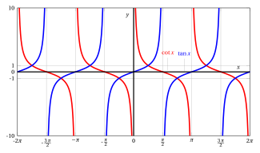
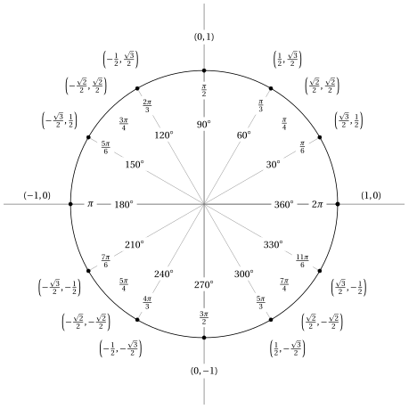
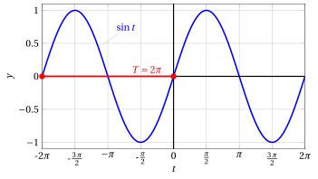
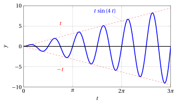
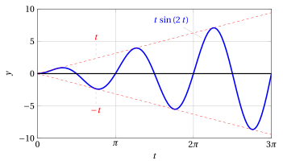
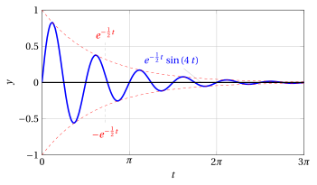

# Trigonometric functions

**Part 3 · Functions · Chapter 6** · [:material-file-pdf-box: Lecture notes, volume 3 (PDF)](../pdf/lecture-notes-3-functions.pdf) · [:material-pencil-box-multiple: Exercises, volume 3 (PDF)](../pdf/exercises-3-functions.pdf) · [:material-presentation: Slides (PDF)](../pdf/slides-functions-05-trigonometric-functions.pdf) · [:material-gesture-tap: App: Harmonic oscillations](../interactive/oscillations.md)

## 1. Trigonometric functions

!!! definizione "Definition 1: sine function and cosine function"

    The trigonometric functions:

    \begin{align}
    \label{seno}  f: \mathbb{R} \rightarrow \mathbb{R},~~~ f: x \mapsto \sin x \\[2ex] 
     \label{coseno}
    f: \mathbb{R} \rightarrow \mathbb{R},~~~ f: x \mapsto \cos x
    \end{align}

    are called <strong>sine</strong> and <strong>cosine</strong>.

- The sine is an <strong>odd</strong> function, while the cosine is an <strong>even</strong> function. Hence we have:

    $$
    \sin(-x)=-\sin x, ~~~\forall x \in \R {\rm ~~~~and~~~~} \cos(-x)=\cos x, ~~~\forall x \in \R
    $$

- The sine and the cosine are periodic functions with period:

    $$
    T=2\: \pi {\rm ~~~~and~we~have~the~fundamental~identity~~~} \sin^2 x + \cos^2 x = 1,~~ \forall x \in \mathbb{R}
    $$

    { .fig .ovale loading=lazy style="width:80%" }

    We have

    $$
    \cos\left(x -\frac{\pi}{2}\right) = \sin x,~~ \forall x \in \mathbb{R}
    $$

- From the sign and the monotonicity of the sine function we have:

    $$
    \sin x = 0 \Longleftrightarrow x= k\;\pi,~ \forall k \in \Z \qquad 
    \begin{cases}
    \sin x > 0 & {\rm if~~~}  x \in (2\;k\;\pi~,~ 2\;k\;\pi + \pi),~ \forall k \in \Z    \\[3ex]
    \sin x < 0 & {\rm if~~~}  x \in (2\;k\;\pi-\pi~,~ 2\;k\;\pi),~ \forall k \in \Z    
    \end{cases}
    $$

    $$
    \begin{cases}
    {\rm if~~~}  x \in (2\;k\;\pi- \frac{\pi}{2},~ 2\;k\;\pi + \frac{\pi}{2}),~ \forall k \in \Z   & f {\rm ~~is~increasing}  \\[3ex]
    {\rm if~~~}  x \in (2\;k\;\pi+ \frac{\pi}{2}~,~ 2\;k\;\pi + \frac{3\;\pi}{2}),~ \forall k \in \Z   & f {\rm ~~is~decreasing}    
    \end{cases}
    $$

- From the sign and the monotonicity of the cosine function we have:

    $$
    \cos x = 0 \Longleftrightarrow x= k\;\pi-\frac{\pi}{2},~ \forall k \in \Z \qquad 
    \begin{cases}
    \cos x > 0 & {\rm if~~~}  x \in (2\;k\;\pi~-\frac{\pi}{2},~ 2\;k\;\pi + \frac{\pi}{2}),~ \forall k \in \Z    \\[3ex]
    \cos x < 0 & {\rm if~~~}  x \in (2\;k\;\pi+\frac{\pi}{2}~,~ 2\;k\;\pi +\frac{3\;\pi}{2}),~ \forall k \in \Z    
    \end{cases}
    $$

    $$
    \begin{cases}
    {\rm if~~~}  x \in (2\;k\;\pi+ \pi,~ 2\;k\;\pi + 2\; \pi),~ \forall k \in \Z   & f {\rm ~~is~increasing}  \\[3ex]
    {\rm if~~~}  x \in (2\;k\;\pi ~,~ 2\;k\;\pi + \pi),~ \forall k \in \Z   & f {\rm ~~is~decreasing}    
    \end{cases}
    $$

!!! chiave ""

    The trigonometric functions:

    \begin{align}
    \label{tangente} f: \mathbb{R} \setminus \{k\;\pi-\frac{\pi}{2},~ \forall k \in \Z\}  \rightarrow \mathbb{R},~~~ f: x \mapsto \tan x = \frac{\sin x}{\cos x} \\[2ex] 
     \label{cotangente}
    f: \mathbb{R}\setminus \{k\;\pi,~ \forall k \in \Z\}  \rightarrow \mathbb{R},~~~ f: x \mapsto \cot x = \frac{\cos x}{\sin x}
    \end{align}

    are called <strong>tangent</strong> and <strong>cotangent</strong>; they are both odd and periodic with period $T=\pi$.

{ .fig .ovale loading=lazy style="width:60%" }

{ .fig .ovale loading=lazy style="width:80%" }

!!! chiave ""

    The trigonometric functions:

    \begin{align}
    \label{secante} f: \mathbb{R} \setminus \{k\;\pi-\frac{\pi}{2},~ \forall k \in \Z\}  \rightarrow \mathbb{R},~~~ f: x \mapsto \sec x = \frac{1}{\cos x} \\[2ex] 
     \label{cosecante}
    f: \mathbb{R}\setminus \{k\;\pi,~ \forall k \in \Z\}  \rightarrow \mathbb{R},~~~ f: x \mapsto \csc x = \frac{1}{\sin x}
    \end{align}

    are called <strong>secant</strong> and <strong>cosecant</strong> and they are periodic with period $T=2\;\pi$. The secant function is even, while the cosecant function is odd.

{ .fig .ovale loading=lazy style="width:80%" }

## 2. Values of the trigonometric functions

<table>
<tr>
<td></td>
<td>\(\cos\)</td>
<td>\(\sin\)</td>
<td>\(\tan\)</td>
<td>\(\cot\)</td>
<td>\(\sec\)</td>
<td>\(\csc\)</td>
</tr>
<tr>
<td>0</td>
<td>1</td>
<td>0</td>
<td>0</td>
<td>\(\pm \infty\)</td>
<td>1</td>
<td>\(\pm \infty\)</td>
</tr>
<tr>
<td>\(x=\frac{\pi}{6}\) (\(30^{\circ}\))</td>
<td>\(\frac{\sqrt{3}}{2}\)</td>
<td>\(\frac{1}{2}\)</td>
<td>\(\frac{\sqrt{3}}{3}\)</td>
<td>\(\sqrt{3}\)</td>
<td>\(\frac{2}{3}\:\sqrt{3}\)</td>
<td>2</td>
</tr>
<tr>
<td>\(x=\frac{\pi}{4}\) (\(45^{\circ}\))</td>
<td>\(\frac{\sqrt{2}}{2}\)</td>
<td>\(\frac{\sqrt{2}}{2}\)</td>
<td>1</td>
<td>1</td>
<td>\(\sqrt{2}\)</td>
<td>\(\sqrt{2}\)</td>
</tr>
<tr>
<td>\(x=\frac{\pi}{3}\) (\(60^{\circ}\))</td>
<td>\(\frac{1}{2}\)</td>
<td>\(\frac{\sqrt{3}}{2}\)</td>
<td>\(\sqrt{3}\)</td>
<td>\(\frac{\sqrt{3}}{3}\)</td>
<td>2</td>
<td>\(\frac{2}{3}\: \sqrt{3}\)</td>
</tr>
<tr>
<td>\(x=\frac{\pi}{2}\) (\(90^{\circ}\))</td>
<td>0</td>
<td>1</td>
<td>\(\pm \infty\)</td>
<td>0</td>
<td>\(\pm \infty\)</td>
<td>1</td>
</tr>
<tr>
<td>\(x=\pi\) (\(180^{\circ}\))</td>
<td>\-1</td>
<td>0</td>
<td>0</td>
<td>\(\pm \infty\)</td>
<td>\-1</td>
<td>\(\pm \infty\)</td>
</tr>
</table>

{ .fig .ovale loading=lazy style="width:68%" }

<table>
<tr>
<td></td>
<td>\(\phantom{-} \cos\)</td>
<td>\(\phantom{-} \sin\)</td>
<td>\(\phantom{-} \tan\)</td>
<td>\(\phantom{-} \cot\)</td>
</tr>
<tr>
<td>\(\phantom{-}x\)</td>
<td>\(\phantom{-} \cos x\)</td>
<td>\(\phantom{-} \sin x\)</td>
<td>\(\phantom{-} \tan x\)</td>
<td>\(\phantom{-} \cot x\)</td>
</tr>
<tr>
<td>\(-x\)</td>
<td>\(\phantom{-} \cos x\)</td>
<td>\(- \sin x\)</td>
<td>\(-\tan x\)</td>
<td>\(-\cot x\)</td>
</tr>
<tr>
<td>\(\frac{\pi}{2} +x\)</td>
<td>\(-\sin x\)</td>
<td>\(\phantom{-} \cos x\)</td>
<td>\(-\cot x\)</td>
<td>\(-\tan x\)</td>
</tr>
<tr>
<td>\(\frac{\pi}{2} - x\)</td>
<td>\(\phantom{-} \sin x\)</td>
<td>\(\phantom{-} \cos x\)</td>
<td>\(\phantom{-} \cot  x\)</td>
<td>\(\phantom{-} \tan x\)</td>
</tr>
<tr>
<td>\(\pi+x\)</td>
<td>\(-\cos x\)</td>
<td>\(-\sin x\)</td>
<td>\(\phantom{-} \tan x\)</td>
<td>\(\phantom{-} \cot x\)</td>
</tr>
<tr>
<td>\(\pi-x\)</td>
<td>\(-\cos x\)</td>
<td>\(\phantom{-} \sin x\)</td>
<td>\(-\tan x\)</td>
<td>\(-\cot x\)</td>
</tr>
</table>

## 3. Main trigonometric formulas

<strong>Relations among the trigonometric functions</strong>

!!! chiave ""

    
<table>
    <tr>
    <td></td>
    <td>\(\sin x\)</td>
    <td>\(\cos x\)</td>
    <td>\(\tan x\)</td>
    <td>\(\cot x\)</td>
    </tr>
    <tr>
    <td>\(\sin x\)</td>
    <td>\-</td>
    <td>\(\pm \sqrt{1 - \cos^2 x}\)</td>
    <td>\(\pm \sqrt{\frac{\tan^2 x}{1 + \tan^2 x}}\)</td>
    <td>\(\pm \sqrt{\frac{1}{1 + \cot^2 x}}\)</td>
    </tr>
    <tr>
    <td>\(\cos x\)</td>
    <td>\(\pm \sqrt{1 - \sin^2 x}\)</td>
    <td>\-</td>
    <td>\(\pm \sqrt{\frac{1}{1 + \tan^2 x}}\)</td>
    <td>\(\pm \sqrt{\frac{\cot^2 x}{1 + \cot^2 x}}\)</td>
    </tr>
    <tr>
    <td>\(\tan x\)</td>
    <td>\(\pm\sqrt{\frac{\sin^2 x}{1 - \sin^2 x}}\)</td>
    <td>\(\pm\sqrt{\frac{1- \cos^2 x}{\cos^2 x}}\)</td>
    <td>\-</td>
    <td>\(\frac{1}{\cot x}\)</td>
    </tr>
    <tr>
    <td>\(\cot x\)</td>
    <td>\(\pm\sqrt{\frac{1- \sin^2 x}{\sin^2 x}}\)</td>
    <td>\(\pm\sqrt{\frac{\cos^2 x}{1 - \cos^2 x}}\)</td>
    <td>\(\frac{1}{\tan x}\)</td>
    <td>\-</td>
    </tr>
    </table>

    where the symbol $\pm$ means that the sign depends on the quadrant in which $x$ lies

<strong>Addition and subtraction</strong>

!!! chiave ""

    \begin{align}
    \label{trig:add}
    \sin ( x_1 \pm x_2)  &= \sin x_1 \: \cos x_2 \pm \sin x_2 \: \cos x_1\\[2ex]
    \cos ( x_1 \pm x_2)  &= \cos x_1 \: \cos x_2 \mp \sin x_1 \: \sin x_2
    \end{align}

!!! chiave ""

    \begin{align}
    \tan ( x_1 \pm x_2)  &= \frac{\tan x_1 \pm \tan x_2}{1 \mp \tan x_1 \: \tan x_2}\\[2ex]
    \cot ( x_1 \pm x_2)  &= \frac{\cot x_1 \: \cot x_2 \mp 1}{\cot x_2 \pm \cot x_1}
    \end{align}

<strong>Double-angle formulas</strong>

!!! chiave ""

    \begin{align}
    \sin ( 2\: x)  &= 2\: \sin x \: \cos x \\[2ex]
    \cos ( 2\: x)  &= \cos^2 x - \sin^2 x \nonumber\\[2ex]
                        &= 2\: \cos^2 x - 1 \nonumber\\[2ex]
                        &= 1 - 2\: \sin^2 x
    \end{align}

!!! chiave ""

    \begin{align}
    \tan ( 2\: x)  &= \frac{2 \:\tan x}{1 - \tan^2 x}\\[2ex]
    \cot ( 2\: x)  &= \frac{\cot^2 x -1}{2\: \cot x}
    \end{align}

<strong>Triple-angle formulas</strong>

!!! chiave ""

    \begin{align}
    \sin ( 3\: x)  &= 3\: \sin x - 4\: \sin^3 x \\[2ex]
    \cos ( 3\: x)  &= 4\: \cos^3 x - 3\: \cos x
    \end{align}

<strong>Half-angle formulas</strong>

!!! chiave ""

    \begin{align}
    \sin  \frac{x}{2}  &= \pm \sqrt{\frac{1 - \cos x}{2}}\\[2ex]
    \cos  \frac{x}{2}  &= \pm \sqrt{\frac{1 + \cos x}{2}}
    \end{align}

!!! chiave ""

    \begin{align}
    \tan  \frac{x}{2}  &= \pm \sqrt{\frac{1 - \cos x}{1 + \cos x}} \nonumber\\[2ex]
        &= \frac{\sin x}{1 + \cos x} \nonumber\\[2ex]
        &= \frac{1 - \cos x}{\sin x}
    \end{align}

!!! chiave ""

    \begin{align}
    \cot  \frac{x}{2}  &= \pm \sqrt{\frac{1 + \cos x}{1 - \cos x}} \nonumber\\[2ex]
        &= \frac{\sin x}{1 - \cos x} \nonumber\\[2ex]
        &= \frac{1 + \cos x}{\sin x}
    \end{align}

<strong>Parametric formulas (tangent half-angle substitution)</strong>

!!! chiave ""

    \begin{align}
    \sin {x}  &= \frac{2\: \tan \frac{{x}}{2}}{1+ \tan^2 \frac{{x}}{2}}\\[2ex]
    \cos {x}  &= \frac{1- \tan^2 \frac{{x}}{2}}{1+ \tan^2 \frac{{x}}{2}}
    \end{align}

<strong>Sum-to-product formulas (prosthaphaeresis)</strong>

!!! chiave ""

    \begin{align}
    \sin  {x_1} + \sin {x_2}  &= \phantom{-} 2\: \sin \frac{x_1 + x_2}{2} \: \cos \frac{x_1 - x_2}{2}\\[2ex]
    \sin  {x_1} - \sin {x_2}  &= \phantom{-}2\: \sin \frac{x_1 - x_2}{2} \: \cos \frac{x_1 + x_2}{2}\\[2ex]
    \cos  {x_1} + \cos {x_2}  &= \phantom{-}2\: \cos \frac{x_1 + x_2}{2} \: \cos \frac{x_1 - x_2}{2}\\[2ex]
    \cos  {x_1} - \cos {x_2}  &= - 2\: \sin \frac{x_1 + x_2}{2} \: \sin \frac{x_1 - x_2}{2}
    \end{align}

<strong>Product-to-sum formulas (Werner's formulas)</strong>

!!! chiave ""

    \begin{align}
    \sin  {x_1} \: \sin {x_2}  &= \frac{1}{2} \bigg(\cos(x_1-x_2) - \cos(x_1 +x_2) \bigg)\\[2ex]
    \sin  {x_1} \: \cos {x_2}  &= \frac{1}{2} \bigg(\sin(x_1-x_2) + \sin(x_1 +x_2) \bigg)\\[2ex]
    \cos  {x_1} \: \cos {x_2}  &= \frac{1}{2} \bigg(\cos(x_1-x_2) + \cos(x_1 +x_2) \bigg)
    \end{align}

<strong>Additional formulas</strong>

!!! chiave ""

    \begin{align}
    \sin^2 x  &= \frac{1 - \cos (2\:x)}{2}\\[2ex]
    \cos^2 x  &= \frac{1 + \cos (2\:x)}{2}\\[2ex]
    \sin  x \:\cos x  &= \frac{\sin (2\:x)}{2}
    \end{align}

## 4. An application: oscillations

The sine and cosine functions are periodic: this is why they are the natural tool to describe phenomena that repeat in time. In this section we apply them to <strong>oscillations</strong> (vibration phenomena).

### 4.1 Vibration phenomena

- We have seen that the sine and cosine functions are periodic with <strong>period</strong> $2\: \pi$. We will use the variable $t$ to denote time.

    { .fig .ovale loading=lazy style="width:80%" }

- Recall that $\sin (t + \varphi)$ corresponds to a <strong>phase shift</strong> $\varphi$ (horizontal translation).

    { .fig .ovale loading=lazy style="width:80%" }

!!! chiave ""

    The functions:

    \begin{equation}
    \label{trig_vibr}
    t \mapsto a\: \sin \:(\omega \: t), \qquad\qquad t \mapsto b\: \cos \:(\omega \: t)
    \end{equation}

    where $a$, $b$ and $\omega$ are positive real numbers, are called <strong>elementary vibrations</strong>.  They are periodic functions with

    $$
    {\rm \textbf{period}~~~} T = \frac{2\:\pi}{\omega}
    $$

!!! esempio "Example 1: period"

    For example, considering $t' = t + \frac{2\: \pi}{\omega}$:

    $$
    \sin \left[ \omega \underbrace{\left( t + \frac{2\: \pi}{\omega} \right)}_{t'}\right] = \sin (\omega \: t + 2\: \pi) = \sin (\omega \: t)
    $$

- Clearly we have:

    $$
    |a\: \sin \:(\omega \: t)| \le a \qquad{\rm ~~and~~}\qquad |b\: \cos \:(\omega \: t)| \le b
    $$

!!! chiave ""

    The functions \(\eqref{trig_vibr}\) describe elementary vibrations characterized by

    $$
    {\rm \textbf{amplitude}~~} a {\rm ~~and~~} b {\rm ~~~~(respectively)}
    $$

    $$
    {\rm \textbf{angular frequency}~~} \omega = \frac{2\: \pi}{T}
    $$

    also called <em>angular velocity</em>, which indicates how many periods there are in an interval of length $2\: \pi$. Moreover, they are characterized by the

    $$
    {\rm \textbf{frequency}~~} \nu = \frac{\omega}{2\:\pi}
    $$

    which indicates how many times the function repeats itself in an interval of length $1$

!!! esempio "Example 2: of amplitude, angular frequency and frequency"

    $$
    t \mapsto 2\: \sin \:\left( \frac{3}{2} \: t \right) \qquad a=2,~ \omega=\frac{3}{2},~ T=\frac{4\:\pi}{3}
    $$

    { .fig .ovale loading=lazy style="width:80%" }

    The angular frequency $\omega=\frac{3}{2}$ means that there are 1.5 periods in an interval of length $2 \: \pi$. The frequency $\nu$ is $\frac{3}{4\:\pi}$.

- The function

    \begin{equation}
    \label{EEE}
    h(t) = a\: \sin \:(\omega \: t) + b\: \cos \:(\omega \: t)
    \end{equation}

    describes the <strong>superposition</strong> of the two elementary vibrations with the <strong>same angular frequency</strong> $\omega$. The latter is again an elementary vibration, <strong>phase-shifted</strong> with respect to the previous ones.

- Indeed, setting

    $$
    A= \sqrt{a^2 + b^2}
    $$

    we can write

    \begin{equation}
    \label{EEEE}
    h(t) = A \: \underbrace{\frac{a}{ \sqrt{a^2 + b^2}}}_{\alpha} \: \sin \:(\omega \: t) + A \: \underbrace{\frac{b}{ \sqrt{a^2 + b^2}}}_{\beta} \: \cos \:(\omega \: t)
    \end{equation}

- Now observe that the numbers

    $$
    \alpha=\frac{a}{ \sqrt{a^2 + b^2}} {\rm ~~and~~} \beta=\frac{b}{ \sqrt{a^2 + b^2}}
    $$

    satisfy the conditions

    $$
    -1 \le \alpha \le 1 \qquad -1 \le \beta \le 1 \qquad  \alpha^2 + \beta^2=1
    $$

    Hence there exists a <strong>unique angle</strong> $\varphi$ such that

    $$
    \cos \varphi = \alpha \qquad \sin \varphi = \beta
    $$

    so that \(\eqref{EEEE}\) can be rewritten in the following form

    \begin{align}
    \label{EEEEE}
    h(t) & = A \: \cos \varphi \: \sin (\omega \:t) + A \: \sin \varphi \: \cos (\omega \:t)\nonumber\\[2ex]
         & = A \: \sin (\omega\:t + \varphi)
    \end{align}

    Therefore $h(t)$ represents an elementary vibration with amplitude $A$, angular frequency $\omega$, phase-shifted by an angle $\varphi$.

    { .fig .ovale loading=lazy style="width:80%" }

In summary:

!!! chiave ""

    \begin{align*}
    a\: \sin \:(\omega \: t) + b\: \cos \:(\omega \: t) = A \: \sin (\omega\:t + \varphi)\\[2ex]
    A = \sqrt{a^2 + b^2} \qquad 
    \begin{cases}
    a= A \: \cos \varphi \\
    b= A \: \sin \varphi 
    \end{cases}
    \end{align*}

- Under fairly general conditions, a periodic natural phenomenon can be written as the superposition of a finite or infinite number of elementary vibrations with different frequencies (<strong>Fourier series</strong>).

<strong>Try it</strong> — the interactive graph below shows what you have just read: move the sliders.

### 4.2 Damping and amplification effects

- By multiplying an elementary vibration by <strong>powers</strong> or <strong>exponentials</strong>, we can model <strong>damping</strong> or <strong>amplification</strong> effects.

<strong>First example</strong>

- For example, consider the function

    $$
    h(t) = t \: \sin \:(\omega \: t)
    $$

    which models an <strong>amplified vibration</strong>.

- Since $-1 \le \sin \:(\omega \: t) \le 1$, we have

    $$
    -t \le t \: \sin \:(\omega \: t) \le t
    $$

    and hence the graph of $h(t)$ lies between the graphs of the lines with equations $y = -t$, $y = t$.

- At the points where

    $$
    \sin \:(\omega\:t) = 1
    $$

    i.e.,

    $$
    t = \frac{\pi}{2 \: \omega} + k \: \frac{2\:\pi}{\omega} \qquad (k=0,1,2,\dots)
    $$

    the graph of $h(t)$ touches that of $y=t$.

- At the points where

    $$
    \sin \:(\omega\:t) = -1
    $$

    i.e.,

    $$
    t = \frac{3\: \pi}{2 \: \omega} + k \: \frac{2\:\pi}{\omega} \qquad (k=0,1,2,\dots)
    $$

    the graph of $h(t)$ touches that of $y=-t$.

    { .fig .ovale loading=lazy style="width:80%" }

- From the graph we can see that multiplication by $t$ has the effect of amplifying the vibration as $t$ increases.

{ .fig .ovale loading=lazy style="width:80%" }

{ .fig .ovale loading=lazy style="width:80%" }

<strong>Second example</strong>

- For example, consider the function

    $$
    k(t) = e^{-\alpha\:t} \: \sin \:(\omega \: t) \qquad (\alpha > 0)
    $$

    which models a <strong>damped vibration</strong>.

- Recalling that

    $$
    e^{-\alpha\:t} = \left(\frac{1}{e^{\alpha}}\right)^t
    $$

    is an exponential with base less than $1$, considerations analogous to those made for the function $h(t)$ show that the graph of $k$ lies between the graphs of the functions

    $$
    y_1 = e^{-\alpha\:t} {\rm ~~~~and~~~~} y_2 = -e^{-\alpha\:t}
    $$

    as shown in the figure:

{ .fig .ovale loading=lazy style="width:80%" }

{ .fig .ovale loading=lazy style="width:80%" }
