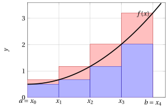
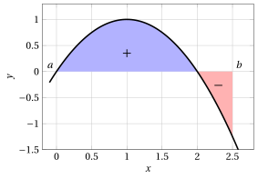
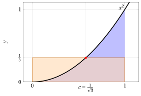

# The Riemann integral

**Part 7 · Integrals · Chapter 1** · [:material-file-pdf-box: Lecture notes, volume 7 (PDF)](../pdf/lecture-notes-7-integrals.pdf) · [:material-pencil-box-multiple: Exercises, volume 7 (PDF)](../pdf/exercises-7-integrals.pdf) · [:material-pencil: Exercises: Riemann integral and properties](../exercises/es-integrals-03-riemann-integral.md) · [:material-presentation: Slides (PDF)](../pdf/slides-integrals-01-riemann-integral.pdf) · [:material-gesture-tap: App: Riemann sums](../interactive/riemann-sums.md)

## 1. Partitions and Riemann sums

!!! definizione "Definition 1: partition of an interval"

    Given an interval $[a,b]$, with $a<b$, a <strong>partition</strong> of $[a,b]$ is a finite set of points

    $$
    P = \{x_0, x_1, \dots, x_n\} {\rm ~~~with~~~} a = x_0 < x_1 < \dots < x_n = b
    $$

    The points $x_k$ divide $[a,b]$ into the $n$ intervals $I_k = [x_{k-1}, x_k]$, with $k \in \{1, 2, \dots, n\}$, of length $\Delta x_k = x_k - x_{k-1}$.

- The partition is called <strong>uniform</strong> when all the intervals have the same length $\Delta x_k = \frac{b-a}{n}$, that is, when $x_k = a + k\,\frac{b-a}{n}$.

- If $P \subseteq P'$, the partition $P'$ is called <strong>finer</strong> than $P$ (or a <strong>refinement</strong> of $P$): it is obtained from $P$ by adding points.

!!! definizione "Definition 2: lower sum and upper sum"

    Let $f:[a,b] \rr \R$ be a bounded function and let $P = \{x_0, x_1, \dots, x_n\}$ be a partition of $[a,b]$. Setting, for every $k \in \{1, 2, \dots, n\}$,

    $$
    m_k = \inf_{x \in I_k} f(x) {\rm ~~~~and~~~~} M_k = \sup_{x \in I_k} f(x)
    $$

    the <strong>lower sum</strong> and the <strong>upper sum</strong> of $f$ with respect to $P$ are the numbers

    $$
    s(f,P) = \sum_{k=1}^{n} m_k \, \Delta x_k {\rm ~~~~and~~~~} S(f,P) = \sum_{k=1}^{n} M_k \, \Delta x_k
    $$

- The bounds $m_k$ and $M_k$ are real numbers because $f$ is bounded. Since $m_k \le M_k$ for every $k$, we always have $s(f,P) \le S(f,P)$.

- If $f \ge 0$, the lower sum is the area of the rectangles <strong>inscribed</strong> in the region under the graph, the upper sum that of the <strong>circumscribed</strong> rectangles.

{ .fig .ovale loading=lazy style="width:65%" }

- In the figure, with $f$ increasing, the blue rectangles form the lower sum and the blue rectangles together with the red ones the upper sum: the area under the graph lies in between.

!!! esempio "Example 1: lower and upper sums of $f(x)=x$"

    Let $f(x) = x$ on $[0,1]$ and let $P_n$ be the uniform partition with $x_k = \frac{k}{n}$. Since $f$ is increasing, on every interval $I_k$ the minimum is at the left endpoint and the maximum at the right endpoint:

    $$
    m_k = \frac{k-1}{n}, ~~~~~ M_k = \frac{k}{n}, ~~~~~ \Delta x_k = \frac{1}{n}
    $$

    With the sum of the first $n$ natural numbers, $\sum_{k=1}^{n} k = \frac{n(n+1)}{2}$, we get

    $$
    S(f,P_n) = \frac{1}{n^2}\sum_{k=1}^{n} k = \frac{n+1}{2n}, ~~~~~~ s(f,P_n) = \frac{1}{n^2}\sum_{k=1}^{n} (k-1) = \frac{n-1}{2n}
    $$

    The difference $S(f,P_n) - s(f,P_n) = \frac{1}{n}$ tends to $0$ and both sums tend to $\frac12$.

!!! teorema "Proposition 1: sums and refinements"

    Let $f:[a,b] \rr \R$ be bounded. If $P'$ is finer than $P$, then

    $$
    s(f,P) \le s(f,P') \le S(f,P') \le S(f,P)
    $$

??? dimostrazione "Proof"

    It is enough to consider the case in which $P'$ has one more point, $y \in (x_{k-1}, x_k)$: the general case follows by adding one point at a time. The two sums differ only on the interval $I_k$, which in $P'$ is split into $[x_{k-1}, y]$ and $[y, x_k]$.

    The infimum over a subset is greater than or equal to the infimum over the whole set, hence

    $$
    m' = \inf_{[x_{k-1},y]} f \ge m_k {\rm ~~~~and~~~~} m'' = \inf_{[y,x_k]} f \ge m_k
    $$

    Consequently

    $$
    m'\,(y - x_{k-1}) + m''\,(x_k - y) \ge m_k\,(y - x_{k-1}) + m_k\,(x_k - y) = m_k \, \Delta x_k
    $$

    that is, $s(f,P') \ge s(f,P)$. For the upper sums we argue in the same way with the suprema, which over a subset are smaller than or equal: $S(f,P') \le S(f,P)$. □

!!! teorema "Corollary 1"

    Let $f:[a,b] \rr \R$ be bounded. For every pair of partitions $P_1$ and $P_2$ of $[a,b]$ we have

    $$
    s(f,P_1) \le S(f,P_2)
    $$

??? dimostrazione "Proof"

    The partition $P = P_1 \cup P_2$ is finer than both $P_1$ and $P_2$. By the Proposition on sums and refinements

    $$
    s(f,P_1) \le s(f,P) \le S(f,P) \le S(f,P_2)
    $$

    
□

- Every upper sum is therefore an upper bound of the set of lower sums. By the completeness axiom the following exist and are finite:

    $$
    \sup_{P} s(f,P) ~~\le~~ \inf_{P} S(f,P)
    $$

    where supremum and infimum are taken over all partitions $P$ of $[a,b]$.

## 2. The Riemann integral

!!! definizione "Definition 3: Riemann integrable function"

    A bounded function $f:[a,b] \rr \R$ is called <strong>Riemann integrable</strong> on $[a,b]$ if

    $$
    \sup_{P} s(f,P) = \inf_{P} S(f,P)
    $$

    The common value is called the <strong>integral</strong> of $f$ on $[a,b]$ and is denoted by

    $$
    \int_a^b f(x) \, dx
    $$

- The function $f$ is called the <strong>integrand</strong>, the numbers $a$ and $b$ are the <strong>limits of integration</strong>.

- The variable $x$ is a <strong>dummy variable</strong>: $\int_a^b f(x)\,dx$, $\int_a^b f(t)\,dt$ and $\int_a^b f(u)\,du$ denote the same number.

- The symbol $\int$ is an elongated $S$ (sum) and $dx$ recalls the widths $\Delta x_k$ of the rectangles.

### 2.1 Geometric interpretation

- If $f \ge 0$ on $[a,b]$, the integral is the <strong>area of the region under the graph</strong> (the subgraph)

    $$
    T_f = \big\{ (x,y) \in \R^2 : a \le x \le b, ~ 0 \le y \le f(x) \big\}
    $$

    which lies between the inscribed rectangles (lower sums) and the circumscribed ones (upper sums).

- If $f$ changes sign, the parts below the $x$-axis count with a minus sign: the integral is a <strong>signed area</strong>, that is, the area above the axis minus the area below the axis.

{ .fig .ovale loading=lazy style="width:65%" }

- In the figure the integral of $f$ on $[a,b]$ is the blue area minus the red area.

!!! esempio "Example 2: integral of a constant"

    Let $f(x) = c$ on $[a,b]$, with $c \in \R$. For every partition $P$ we have $m_k = M_k = c$, hence

    $$
    s(f,P) = S(f,P) = \sum_{k=1}^{n} c \, \Delta x_k = c\,(b-a)
    $$

    The constant function is integrable and

    $$
    \int_a^b c \, dx = c\,(b-a)
    $$

    If $c>0$ this is the area of the rectangle with base $b-a$ and height $c$.

!!! esempio "Example 3: integral of $f(x)=x$"

    Let us go back to $f(x) = x$ on $[0,1]$ and to the uniform partitions $P_n$ of the Example on the lower and upper sums of $f(x)=x$. For every $n$

    $$
    \frac{n-1}{2n} = s(f,P_n) \le \sup_{P} s(f,P) \le \inf_{P} S(f,P) \le S(f,P_n) = \frac{n+1}{2n}
    $$

    Letting $n \rr \ip$ both ends tend to $\frac12$, hence

    $$
    \sup_{P} s(f,P) = \inf_{P} S(f,P) = \frac12 {\rm ~~~~that~is~~~~} \int_0^1 x \, dx = \frac12
    $$

    This is the area of the triangle with vertices $(0,0)$, $(1,0)$ and $(1,1)$.

!!! esempio "Example 4: integral of $f(x)=x^2$"

    Let $f(x) = x^2$ on $[0,1]$ and $P_n$ the uniform partition. The function is increasing on $[0,1]$, so $m_k = \left(\frac{k-1}{n}\right)^2$ and $M_k = \left(\frac{k}{n}\right)^2$. Using the formula $\sum_{k=1}^{n} k^2 = \frac{n(n+1)(2n+1)}{6}$ (it is proved by induction) we get

    $$
    S(f,P_n) = \frac{1}{n^3}\sum_{k=1}^{n} k^2 = \frac{(n+1)(2n+1)}{6n^2}, ~~~~~~ s(f,P_n) = \frac{1}{n^3}\sum_{k=1}^{n-1} k^2 = \frac{(n-1)(2n-1)}{6n^2}
    $$

    Both tend to $\frac{2}{6} = \frac13$ as $n \rr \ip$; arguing as in the previous example

    $$
    \int_0^1 x^2 \, dx = \frac13
    $$

!!! esempio "Example 5: a non-integrable function"

    The <strong>Dirichlet function</strong> on $[0,1]$ is

    $$
    D(x) = \begin{cases} 1 & {\rm if~} x \in \Q \\ 0 & {\rm if~} x \notin \Q \end{cases}
    $$

    Every interval $I_k$ contains both rational and irrational numbers (density of $\Q$ and of $\R \setminus \Q$ in $\R$), so $m_k = 0$ and $M_k = 1$ for every $k$. For every partition

    $$
    s(D,P) = 0 {\rm ~~~~and~~~~} S(D,P) = \sum_{k=1}^{n} \Delta x_k = 1
    $$

    Hence $\sup_P s(D,P) = 0 \neq 1 = \inf_P S(D,P)$: the Dirichlet function is bounded but it is <strong>not</strong> Riemann integrable.

### 2.2 Integrability criterion

!!! teorema "Theorem 1: Riemann's integrability criterion"

    A bounded function $f:[a,b] \rr \R$ is integrable on $[a,b]$ if and only if for every $\varepsilon > 0$ there exists a partition $P$ of $[a,b]$ such that

    $$
    S(f,P) - s(f,P) < \varepsilon
    $$

??? dimostrazione "Proof"

    Let $I_- = \sup_P s(f,P)$ and $I^+ = \inf_P S(f,P)$; we know that $I_- \le I^+$.

    - <strong>($\Leftarrow$)</strong> For every $\varepsilon > 0$ there is $P$ with $s(f,P) \le I_- \le I^+ \le S(f,P)$ and $S(f,P) - s(f,P) < \varepsilon$. Hence $0 \le I^+ - I_- < \varepsilon$ for every $\varepsilon > 0$, that is, $I^+ = I_-$.

    - <strong>($\Rightarrow$)</strong> Let $I = I_- = I^+$ and let $\varepsilon > 0$. By the properties of supremum and infimum there exist $P_1$ and $P_2$ with

        $$
        s(f,P_1) > I - \frac{\varepsilon}{2} {\rm ~~~~and~~~~} S(f,P_2) < I + \frac{\varepsilon}{2}
        $$

        With $P = P_1 \cup P_2$, by the Proposition on sums and refinements, $S(f,P) - s(f,P) \le S(f,P_2) - s(f,P_1) < \varepsilon$.

    
□

### 2.3 Riemann sums

- Choosing a point $t_k$ in each interval $I_k$, the sum $\sigma(f,P) = \sum_{k=1}^{n} f(t_k)\,\Delta x_k$ is called a <strong>Riemann sum</strong>.

- Since $m_k \le f(t_k) \le M_k$, we have $s(f,P) \le \sigma(f,P) \le S(f,P)$: if $f$ is integrable and $S(f,P) - s(f,P) \rr 0$, the Riemann sums tend to the integral too, whatever the choice of the points $t_k$.

- For continuous functions with uniform partitions, $t_k$ can be the left endpoint, the right endpoint or the midpoint of $I_k$: this is how an integral is approximated on a computer.

<strong>Try it</strong> — the interactive graph below shows what you have just read: move the sliders.

## 3. Classes of integrable functions

!!! teorema "Theorem 2: integrability of monotone functions"

    If $f:[a,b] \rr \R$ is monotone, then $f$ is integrable on $[a,b]$.

??? dimostrazione "Proof"

    Assume $f$ non-decreasing (the non-increasing case is analogous). The function is bounded, because $f(a) \le f(x) \le f(b)$. Let $P_n$ be the uniform partition, with $\Delta x_k = \frac{b-a}{n}$. On every interval $I_k$ we have $m_k = f(x_{k-1})$ and $M_k = f(x_k)$, hence

    $$
    S(f,P_n) - s(f,P_n) = \frac{b-a}{n} \sum_{k=1}^{n} \big( f(x_k) - f(x_{k-1}) \big) = \frac{(b-a)\,\big(f(b) - f(a)\big)}{n}
    $$

    because the sum telescopes. Given $\varepsilon > 0$, it is enough to take $n > \frac{(b-a)(f(b) - f(a))}{\varepsilon}$ to get $S(f,P_n) - s(f,P_n) < \varepsilon$. By Riemann's integrability criterion, $f$ is integrable. □

- A monotone function may have discontinuity points: for example the integer part $[x]$ is integrable on every interval $[a,b]$, even though it has a jump at every integer.

### 3.1 Uniform continuity

!!! definizione "Definition 4: uniformly continuous function"

    A function $f: I \rr \R$ is called <strong>uniformly continuous</strong> on the interval $I$ if for every $\varepsilon > 0$ there exists $\delta > 0$ such that

    $$
    x, y \in I, ~~ |x - y| < \delta ~~~\Longrightarrow~~~ |f(x) - f(y)| < \varepsilon
    $$

- In continuity at every point the number $\delta$ may depend on the point; in uniform continuity the same $\delta$ works for all the points of $I$.

- A function that is uniformly continuous on $I$ is continuous at every point of $I$.

!!! esempio "Example 6: uniform continuity"

    The function $f(x) = x^2$ is uniformly continuous on $[0,1]$: for $x, y \in [0,1]$

    $$
    |x^2 - y^2| = |x+y|\,|x-y| \le 2\,|x - y|
    $$

    and it is enough to choose $\delta = \frac{\varepsilon}{2}$.

    The function $g(x) = \frac{1}{x}$ is continuous on $(0,1]$ but not uniformly continuous: the points $x_n = \frac1n$ and $y_n = \frac{1}{n+1}$ have distance $\frac{1}{n(n+1)} \rr 0$, while $|g(x_n) - g(y_n)| = 1$ for every $n$.

!!! teorema "Theorem 3: Heine–Cantor theorem"

    If $f:[a,b] \rr \R$ is continuous on the closed and bounded interval $[a,b]$, then $f$ is uniformly continuous on $[a,b]$.

??? dimostrazione "Proof"

    By contradiction: there exists $\varepsilon > 0$ such that for every $n \ge 1$ there are $x_n, y_n \in [a,b]$ with

    $$
    |x_n - y_n| < \frac1n {\rm ~~~~and~~~~} |f(x_n) - f(y_n)| \ge \varepsilon
    $$

    The sequence $\{x_n\}$ is bounded. By the Bolzano–Weierstrass theorem (every bounded sequence has a convergent subsequence: it is proved with the same bisection used for the Weierstrass theorem) there exists a subsequence $x_{n_j} \rr c$, with $c \in [a,b]$ because the interval is closed.

    Since $|x_{n_j} - y_{n_j}| < \frac{1}{n_j}$, also $y_{n_j} \rr c$. By the continuity of $f$ at $c$

    $$
    f(x_{n_j}) - f(y_{n_j}) \rr f(c) - f(c) = 0
    $$

    which contradicts $|f(x_{n_j}) - f(y_{n_j})| \ge \varepsilon$ for every $j$. □

### 3.2 Integrability of continuous functions

!!! teorema "Theorem 4: integrability of continuous functions"

    If $f:[a,b] \rr \R$ is continuous, then $f$ is integrable on $[a,b]$.

??? dimostrazione "Proof"

    By the Weierstrass theorem $f$ is bounded. Let $\varepsilon > 0$. By the Heine–Cantor theorem there exists $\delta > 0$ such that

    $$
    |x - y| < \delta ~~~\Longrightarrow~~~ |f(x) - f(y)| < \frac{\varepsilon}{b-a}
    $$

    Take a partition $P$ with all intervals of length $\Delta x_k < \delta$. On every $I_k$, by the Weierstrass theorem, $f$ has a minimum $m_k = f(\xi_k)$ and a maximum $M_k = f(\eta_k)$, with $|\xi_k - \eta_k| \le \Delta x_k < \delta$. Hence $M_k - m_k < \frac{\varepsilon}{b-a}$ and

    $$
    S(f,P) - s(f,P) = \sum_{k=1}^{n} (M_k - m_k)\,\Delta x_k < \frac{\varepsilon}{b-a} \sum_{k=1}^{n} \Delta x_k = \varepsilon
    $$

    By Riemann's integrability criterion, $f$ is integrable. □

!!! osservazione "Remark 1"

    One can prove that a function which is bounded on $[a,b]$ and continuous except at finitely many points is integrable as well. Moreover, changing an integrable function at finitely many points gives an integrable function with the same integral.

## 4. Properties of the integral

- It is convenient to extend the integral symbol to the case of equal or swapped limits:

    $$
    \int_a^a f(x)\,dx = 0 {\rm ~~~~and~~~~} \int_b^a f(x)\,dx = -\int_a^b f(x)\,dx
    $$

### 4.1 Linearity

!!! teorema "Theorem 5: linearity of the integral"

    If $f$ and $g$ are integrable on $[a,b]$ and $\alpha, \beta \in \R$, then $\alpha f + \beta g$ is integrable on $[a,b]$ and

    $$
    \int_a^b \big( \alpha f(x) + \beta g(x) \big)\, dx = \alpha \int_a^b f(x)\,dx + \beta \int_a^b g(x)\,dx
    $$

??? dimostrazione "Proof"

    It is enough to treat separately the sum $f+g$ and the multiple $\alpha f$.

    - <strong>Sum.</strong> On every interval $I_k$ we have $\inf (f+g) \ge \inf f + \inf g$ and $\sup (f+g) \le \sup f + \sup g$, hence

        $$
        s(f,P) + s(g,P) \le s(f+g,P) \le S(f+g,P) \le S(f,P) + S(g,P)
        $$

        Given $\varepsilon > 0$, by Riemann's integrability criterion and the Proposition on sums and refinements there is a partition $P$ (the union of those that work for $f$ and for $g$) with $S - s < \frac{\varepsilon}{2}$ both for $f$ and for $g$. Then $S(f+g,P) - s(f+g,P) < \varepsilon$ and $f+g$ is integrable. Moreover $\int (f+g)$ and $\int f + \int g$ both lie between $s(f,P)+s(g,P)$ and $S(f,P)+S(g,P)$: their distance is less than $\varepsilon$ for every $\varepsilon > 0$, so they coincide.

    - <strong>Multiple.</strong> If $\alpha \ge 0$, then $\inf (\alpha f) = \alpha \inf f$ and $\sup (\alpha f) = \alpha \sup f$, hence $s(\alpha f, P) = \alpha\, s(f,P)$ and $S(\alpha f,P) = \alpha\, S(f,P)$. If $\alpha < 0$, infimum and supremum are swapped: $s(\alpha f,P) = \alpha\, S(f,P)$ and $S(\alpha f,P) = \alpha\, s(f,P)$. In both cases $\int \alpha f = \alpha \int f$.

    
□

### 4.2 Additivity with respect to the interval

!!! teorema "Theorem 6: additivity with respect to the interval"

    Let $a < c < b$. A function $f$ is integrable on $[a,b]$ if and only if it is integrable on $[a,c]$ and on $[c,b]$, and in that case

    $$
    \int_a^b f(x)\,dx = \int_a^c f(x)\,dx + \int_c^b f(x)\,dx
    $$

??? dimostrazione "Proof"

    By the Proposition on sums and refinements we may use only partitions $P$ of $[a,b]$ containing $c$ (adding $c$ does not increase the difference $S - s$). Such a $P$ is the union of a partition $P_1$ of $[a,c]$ and a partition $P_2$ of $[c,b]$, and

    $$
    s(f,P) = s(f,P_1) + s(f,P_2), ~~~~~~ S(f,P) = S(f,P_1) + S(f,P_2)
    $$

    Hence $S(f,P) - s(f,P)$ is the sum of the two differences, both non-negative: it is smaller than $\varepsilon$ if and only if both are (up to halving $\varepsilon$). By Riemann's integrability criterion the two integrability conditions are equivalent. Finally $\int_a^b f$ and $\int_a^c f + \int_c^b f$ both lie between $s(f,P)$ and $S(f,P)$, whose distance is less than $\varepsilon$: they coincide. □

- With the convention on swapped limits, the additivity formula holds for $a$, $b$, $c$ in any order, provided that $f$ is integrable on the largest interval.

!!! esempio "Example 7: additivity"

    Let $f(x) = x$ for $x \in [0,1]$ and $f(x) = 1$ for $x \in [1,3]$. The function is continuous, hence integrable, and by additivity

    $$
    \int_0^3 f(x)\,dx = \int_0^1 x \, dx + \int_1^3 1 \, dx = \frac12 + 2 = \frac52
    $$

    where we used the Example on the integral of $f(x)=x$ and the one on the integral of a constant.

### 4.3 Monotonicity and absolute value

!!! teorema "Theorem 7: monotonicity of the integral"

    If $f$ and $g$ are integrable on $[a,b]$ and $f(x) \le g(x)$ for every $x \in [a,b]$, then

    $$
    \int_a^b f(x)\,dx \le \int_a^b g(x)\,dx
    $$

??? dimostrazione "Proof"

    On every interval $I_k$ we have $\inf f \le \inf g$, hence $s(f,P) \le s(g,P) \le \int_a^b g$ for every partition $P$. Taking the supremum over $P$, $\int_a^b f = \sup_P s(f,P) \le \int_a^b g$. □

!!! teorema "Corollary 2: estimates of the integral"

    Let $f$ be integrable on $[a,b]$.

    - If $f(x) \ge 0$ for every $x \in [a,b]$, then $\int_a^b f(x)\,dx \ge 0$.

    - If $m \le f(x) \le M$ for every $x \in [a,b]$, then

        $$
        m\,(b-a) \le \int_a^b f(x)\,dx \le M\,(b-a)
        $$

??? dimostrazione "Proof"

    Apply the theorem on the monotonicity of the integral comparing $f$ with the constants $0$, $m$ and $M$, whose integrals are given by the Example on the integral of a constant. □

!!! esempio "Example 8: an estimate without computing the integral"

    On $[0,1]$ the function $f(x) = e^{-x^2}$ is decreasing, so $e^{-1} \le f(x) \le 1$. By the Corollary on the estimates of the integral

    $$
    \frac{1}{e} \le \int_0^1 e^{-x^2}\,dx \le 1
    $$

    even though $e^{-x^2}$ has no elementary antiderivative.

!!! teorema "Theorem 8: integral of the absolute value"

    If $f$ is integrable on $[a,b]$, then $|f|$ is integrable on $[a,b]$ too and

    $$
    \left| \int_a^b f(x)\,dx \right| \le \int_a^b |f(x)|\,dx
    $$

??? dimostrazione "Proof"

    - <strong>Integrability of $|f|$.</strong> For $x, y \in I_k$ we have $\big| |f(x)| - |f(y)| \big| \le |f(x) - f(y)| \le M_k - m_k$. Taking the supremum in $x$ and the infimum in $y$, the difference between the supremum and the infimum of $|f|$ on $I_k$ is at most $M_k - m_k$. Hence $S(|f|,P) - s(|f|,P) \le S(f,P) - s(f,P)$ and we conclude with Riemann's integrability criterion.

    - <strong>Inequality.</strong> From $-|f(x)| \le f(x) \le |f(x)|$, by the linearity and the monotonicity of the integral,

        $$
        -\int_a^b |f(x)|\,dx \le \int_a^b f(x)\,dx \le \int_a^b |f(x)|\,dx
        $$

        which is the claim.

    
□

!!! esempio "Example 9: the inequality can be strict"

    Let $f(x) = x$ on $[-1,1]$. The signed areas of the two triangles cancel out, while for $|x|$ they add up:

    $$
    \int_{-1}^{1} x\,dx = -\frac12 + \frac12 = 0, ~~~~~~ \int_{-1}^{1} |x|\,dx = \frac12 + \frac12 = 1
    $$

    Hence $\left|\int_{-1}^1 x\,dx\right| = 0 < 1 = \int_{-1}^1 |x|\,dx$.

## 5. Integral mean value theorem

!!! definizione "Definition 5: integral mean"

    Let $f$ be integrable on $[a,b]$. The <strong>integral mean</strong> (or mean value) of $f$ on $[a,b]$ is the number

    $$
    \frac{1}{b-a} \int_a^b f(x)\,dx
    $$

- If $f \ge 0$, the integral mean is the height of the rectangle with base $[a,b]$ having the same area as the region under the graph of $f$.

!!! teorema "Theorem 9: integral mean value theorem"

    If $f:[a,b] \rr \R$ is continuous, then there exists $c \in [a,b]$ such that

    $$
    f(c) = \frac{1}{b-a} \int_a^b f(x)\,dx
    $$

??? dimostrazione "Proof"

    By the Weierstrass theorem $f$ has a minimum $m$ and a maximum $M$ on $[a,b]$. By the Corollary on the estimates of the integral

    $$
    m\,(b-a) \le \int_a^b f(x)\,dx \le M\,(b-a) ~~~\Longrightarrow~~~ m \le \frac{1}{b-a}\int_a^b f(x)\,dx \le M
    $$

    The integral mean is therefore a value between the minimum and the maximum of $f$. By the intermediate value theorem $f$ takes all values between $m$ and $M$: there exists $c \in [a,b]$ at which $f(c)$ equals the integral mean. □

{ .fig .ovale loading=lazy style="width:65%" }

!!! esempio "Example 10: integral mean of $x^2$"

    By the Example on the integral of $f(x)=x^2$, the integral mean of $x^2$ on $[0,1]$ is

    $$
    \frac{1}{1-0}\int_0^1 x^2\,dx = \frac13
    $$

    The point of the integral mean value theorem is found by solving $c^2 = \frac13$ with $c \in [0,1]$: $c = \frac{1}{\sqrt3}$. In the figure the orange rectangle of height $\frac13$ has the same area as the blue region under the parabola.

!!! osservazione "Remark 2"

    The continuity assumption cannot be dropped. The function $f(x) = 0$ for $x \in [0,1)$ and $f(x) = 1$ for $x \in [1,2]$ is integrable (it is monotone) and, by additivity and the Remark on changes at finitely many points, its integral mean is $\frac12 \int_0^2 f(x)\,dx = \frac12$, a value that $f$ does not take.

!!! chiave "In summary"

    - For a bounded function and a partition of $[a,b]$, the lower sum uses the infima and the upper sum the suprema; refining the partition the former increases and the latter decreases.

    - $f$ is integrable if the supremum of the lower sums equals the infimum of the upper sums; equivalently, if $S(f,P) - s(f,P)$ can be made arbitrarily small.

    - If $f \ge 0$ the integral is the area under the graph; in general it is a signed area.

    - Monotone functions and continuous functions on $[a,b]$ are integrable (for continuous ones we need the Heine–Cantor theorem); the Dirichlet function is not.

    - The integral is linear, additive with respect to the interval and monotone, and $\left|\int_a^b f\right| \le \int_a^b |f|$.

    - A continuous function takes its integral mean at least at one point of $[a,b]$.

---

**Exercises on this chapter:** [:material-pencil: Riemann integral and properties](../exercises/es-integrals-03-riemann-integral.md)

