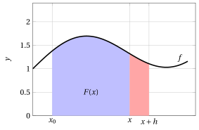

# Fundamental theorem of calculus

**Part 7 · Integrals · Chapter 2** · [:material-file-pdf-box: Lecture notes, volume 7 (PDF)](../pdf/lecture-notes-7-integrals.pdf) · [:material-pencil-box-multiple: Exercises, volume 7 (PDF)](../pdf/exercises-7-integrals.pdf) · [:material-pencil: Exercises: Antiderivatives](../exercises/es-integrals-01-antiderivatives.md) · [:material-pencil: Exercises: Integral functions and the fundamental theorem](../exercises/es-integrals-04-integral-functions.md) · [:material-presentation: Slides (PDF)](../pdf/slides-integrals-02-fundamental-theorem.pdf)

## 1. Antiderivatives

!!! definizione "Definition 1: antiderivative"

    Let $f: I \rr \R$, with $I$ an interval. A function $F: I \rr \R$ is called an <strong>antiderivative</strong> (or primitive) of $f$ on $I$ if $F$ is differentiable on $I$ and

    $$
    F'(x) = f(x), ~~~ \forall x \in I
    $$

- Finding an antiderivative is the inverse process of differentiation: we look for a function knowing its derivative.

- If $I$ contains an endpoint, the derivative at that point is one-sided.

!!! esempio "Example 1: antiderivatives"

    - $F(x) = \frac{x^3}{3}$ is an antiderivative of $f(x) = x^2$ on $\R$, because $F'(x) = x^2$; so is $\frac{x^3}{3} + 5$.

    - $F(x) = \sin x$ is an antiderivative of $f(x) = \cos x$ on $\R$.

    - $F(x) = \log x$ is an antiderivative of $f(x) = \frac1x$ on $(0, \ip)$; $F(x) = \log(-x)$ is one on $(\im, 0)$.

!!! teorema "Theorem 1: characterization of antiderivatives"

    Let $F$ be an antiderivative of $f$ on the interval $I$. Then $G$ is an antiderivative of $f$ on $I$ if and only if there exists a constant $c \in \R$ such that

    $$
    G(x) = F(x) + c, ~~~ \forall x \in I
    $$

??? dimostrazione "Proof"

    - <strong>($\Leftarrow$)</strong> If $G = F + c$, then $G' = F' + 0 = f$ on $I$.

    - <strong>($\Rightarrow$)</strong> The function $H = G - F$ has derivative $H' = f - f = 0$ on the whole interval $I$. By the corollary of Lagrange's theorem, a function with zero derivative on an interval is constant: $H(x) = c$ for every $x \in I$.

    
□

!!! osservazione "Remark 1"

    The assumption that $I$ is an interval is essential. On $\R \setminus \{0\}$ the functions

    $$
    F(x) = \log|x| {\rm ~~~~and~~~~} G(x) = \begin{cases} \log|x| + 1 & {\rm if~} x > 0 \\ \log|x| & {\rm if~} x < 0 \end{cases}
    $$

    both have derivative $\frac1x$, but $G - F$ is not constant: it equals $1$ for $x > 0$ and $0$ for $x < 0$.

!!! definizione "Definition 2: indefinite integral"

    The set of all antiderivatives of $f$ on an interval $I$ is called the <strong>indefinite integral</strong> of $f$ and is denoted by $\int f(x)\,dx$. If $F$ is an antiderivative, we write

    $$
    \int f(x)\,dx = F(x) + c, ~~~ c \in \R
    $$

- From the linearity of the derivative follows the <strong>linearity of the indefinite integral</strong>: $\int (\alpha f + \beta g)\,dx = \alpha \int f\,dx + \beta \int g\,dx$.

- The indefinite integral, which is a set of functions, must not be confused with the definite integral $\int_a^b f(x)\,dx$, which is a number. The fundamental theorem of calculus shows the link between the two.

## 2. The integral function

!!! definizione "Definition 3: integral function"

    Let $f$ be integrable on $[a,b]$ and let $x_0 \in [a,b]$. The function

    $$
    F(x) = \int_{x_0}^{x} f(t)\,dt, ~~~ x \in [a,b]
    $$

    is called the <strong>integral function</strong> of $f$ with initial point $x_0$.

- The integration variable is called $t$ so as not to confuse it with the upper limit $x$.

- For $x < x_0$ the convention $\int_{x_0}^{x} f = -\int_{x}^{x_0} f$ applies; moreover $F(x_0) = 0$.

!!! esempio "Example 2: an integral function"

    Let $f(t) = t$ and $x_0 = 0$. For $x > 0$ the integral $\int_0^x t\,dt$ is the area of the triangle with base and height $x$, that is, $\frac{x^2}{2}$. For $x < 0$

    $$
    \int_0^x t\,dt = -\int_x^0 t\,dt = -\left(-\frac{x^2}{2}\right) = \frac{x^2}{2}
    $$

    because between $x$ and $0$ the graph lies below the axis. Hence $F(x) = \frac{x^2}{2}$ for every $x \in \R$: the integral function of $f(t) = t$ is an antiderivative of it.

!!! teorema "Proposition 1: continuity of the integral function"

    If $f$ is integrable on $[a,b]$ and $|f(t)| \le L$ for every $t \in [a,b]$, then the integral function $F$ satisfies

    $$
    |F(x) - F(y)| \le L\,|x - y|, ~~~ \forall x, y \in [a,b]
    $$

    In particular $F$ is continuous on $[a,b]$.

??? dimostrazione "Proof"

    Let $y < x$. By additivity with respect to the interval, $F(x) - F(y) = \int_y^x f(t)\,dt$. By the inequality for the absolute value and the Corollary on the estimates of the integral

    $$
    |F(x) - F(y)| \le \int_y^x |f(t)|\,dt \le L\,(x - y)
    $$

    As $y \rr x$ the right-hand side tends to $0$, so $F$ is continuous. □

## 3. Fundamental theorem of calculus

!!! teorema "Theorem 2: fundamental theorem of calculus, first part"

    Let $f:[a,b] \rr \R$ be continuous and let $x_0 \in [a,b]$. The integral function

    $$
    F(x) = \int_{x_0}^{x} f(t)\,dt
    $$

    is differentiable on $[a,b]$ and

    $$
    F'(x) = f(x), ~~~ \forall x \in [a,b]
    $$

    that is, $F$ is an antiderivative of $f$ on $[a,b]$.

??? dimostrazione "Proof"

    Let $x \in [a,b]$ and let $h \neq 0$ with $x + h \in [a,b]$. By additivity with respect to the interval

    $$
    \frac{F(x+h) - F(x)}{h} = \frac{1}{h}\int_x^{x+h} f(t)\,dt
    $$

    The right-hand side is the integral mean of $f$ on the interval with endpoints $x$ and $x+h$ (also for $h < 0$, swapping the limits). By the integral mean value theorem there exists $c_h$ between $x$ and $x + h$ such that

    $$
    \frac{F(x+h) - F(x)}{h} = f(c_h)
    $$

    As $h \rr 0$ we have $c_h \rr x$ and, by the continuity of $f$, $f(c_h) \rr f(x)$. The limit of the difference quotient exists and equals $f(x)$. □

{ .fig .ovale loading=lazy style="width:65%" }

- In the figure the blue area is $F(x)$ and the red strip is $F(x+h) - F(x)$: for small $h$ it is almost a rectangle with base $h$ and height $f(x)$. Dividing by $h$ we get about $f(x)$.

- Hence every continuous function on an interval has an antiderivative, even when it cannot be written with elementary functions (for example $e^{-x^2}$).

!!! teorema "Theorem 3: fundamental theorem of calculus, second part"

    Let $f:[a,b] \rr \R$ be continuous and let $G$ be any antiderivative of $f$ on $[a,b]$. Then

    $$
    \int_a^b f(x)\,dx = G(b) - G(a)
    $$

??? dimostrazione "Proof"

    By the fundamental theorem of calculus, first part, the function $F(x) = \int_a^x f(t)\,dt$ is an antiderivative of $f$ on $[a,b]$. By the theorem on the characterization of antiderivatives there exists $c \in \R$ with $G = F + c$ on $[a,b]$. Then

    $$
    G(b) - G(a) = \big(F(b) + c\big) - \big(F(a) + c\big) = \int_a^b f(t)\,dt - 0
    $$

    
□

- We write $G(b) - G(a) = \big[ G(x) \big]_a^b$. The second part is also called the <strong>fundamental formula of integral calculus</strong>: to compute a definite integral an antiderivative is enough.

!!! esempio "Example 3: definite integrals with an antiderivative"

    - $\displaystyle \int_0^1 x^2\,dx = \left[\frac{x^3}{3}\right]_0^1 = \frac13$, as we found with Riemann sums.

    - $\displaystyle \int_0^{\pi} \sin x\,dx = \big[-\cos x\big]_0^{\pi} = -\cos\pi + \cos 0 = 2$.

    - $\displaystyle \int_1^{e} \frac{1}{x}\,dx = \big[\log x\big]_1^{e} = 1 - 0 = 1$.

    - $\displaystyle \int_0^{2\pi} \sin x\,dx = \big[-\cos x\big]_0^{2\pi} = 0$, while $\displaystyle \int_0^{2\pi} |\sin x|\,dx = 2\int_0^{\pi} \sin x\,dx = 4$.

## 4. Basic antiderivatives

- Reading the table of the derivatives of elementary functions backwards we get the <strong>basic antiderivatives</strong>. Each row is checked by differentiating the right-hand side.

<table>
<tr>
<td>\(f(x)\)</td>
<td>\(\displaystyle\int f(x)\,dx\)</td>
</tr>
<tr>
<td>\(x^{\alpha}\),   \(\alpha \neq -1\)</td>
<td>\(\displaystyle\frac{x^{\alpha+1}}{\alpha+1} + c\)</td>
</tr>
<tr>
<td>\(\displaystyle\frac{1}{x}\)</td>
<td>\(\log|x| + c\)</td>
</tr>
<tr>
<td>\(e^{x}\)</td>
<td>\(e^{x} + c\)</td>
</tr>
<tr>
<td>\(a^{x}\),   \(a > 0\), \(a \neq 1\)</td>
<td>\(\displaystyle\frac{a^{x}}{\log a} + c\)</td>
</tr>
<tr>
<td>\(\sin x\)</td>
<td>\(-\cos x + c\)</td>
</tr>
<tr>
<td>\(\cos x\)</td>
<td>\(\sin x + c\)</td>
</tr>
<tr>
<td>\(\displaystyle\frac{1}{\cos^2 x} = 1 + \tan^2 x\)</td>
<td>\(\tan x + c\)</td>
</tr>
<tr>
<td>\(\displaystyle\frac{1}{1+x^2}\)</td>
<td>\(\arctan x + c\)</td>
</tr>
<tr>
<td>\(\displaystyle\frac{1}{\sqrt{1-x^2}}\)</td>
<td>\(\arcsin x + c\)</td>
</tr>
<tr>
<td>\(\sinH x\)</td>
<td>\(\cosH x + c\)</td>
</tr>
<tr>
<td>\(\cosH x\)</td>
<td>\(\sinH x + c\)</td>
</tr>
</table>

- Each formula holds on an interval where the function is defined: for example $\int \frac1x\,dx = \log|x| + c$ on $(0,\ip)$ or on $(\im, 0)$.

- By the chain rule, if $g$ is differentiable, the table also holds in <strong>composite</strong> form: for example

    $$
    \int g'(x)\, g(x)^{\alpha}\,dx = \frac{g(x)^{\alpha+1}}{\alpha+1} + c, ~~~~ \int \frac{g'(x)}{g(x)}\,dx = \log|g(x)| + c, ~~~~ \int g'(x)\, e^{g(x)}\,dx = e^{g(x)} + c
    $$

!!! esempio "Example 4: basic antiderivatives and linearity"

    - $\displaystyle \int \left(3x^2 - \frac{4}{x} + 2e^x\right) dx = x^3 - 4\log|x| + 2e^x + c$.

    - $\displaystyle \int \sqrt{x}\,dx = \int x^{1/2}\,dx = \frac{2}{3}\,x^{3/2} + c$, on $(0, \ip)$.

    - $\displaystyle \int \tan x\,dx = -\int \frac{-\sin x}{\cos x}\,dx = -\log|\cos x| + c$, with $g(x) = \cos x$.

    - $\displaystyle \int \frac{x}{1+x^2}\,dx = \frac12 \int \frac{2x}{1+x^2}\,dx = \frac12 \log(1+x^2) + c$.

    - $\displaystyle \int_0^1 \frac{1}{1+x^2}\,dx = \big[\arctan x\big]_0^1 = \frac{\pi}{4}$.

## 5. Derivative of an integral function

!!! teorema "Theorem 4: differentiation of integral functions"

    Let $f$ be continuous on the interval $I$ and let $\alpha$ and $\beta$ be differentiable functions on an interval $J$, with values in $I$. Then the function

    $$
    G(x) = \int_{\alpha(x)}^{\beta(x)} f(t)\,dt, ~~~ x \in J
    $$

    is differentiable on $J$ and

    $$
    G'(x) = f\big(\beta(x)\big)\,\beta'(x) - f\big(\alpha(x)\big)\,\alpha'(x)
    $$

??? dimostrazione "Proof"

    Let $F$ be an antiderivative of $f$ on $I$, which exists by the fundamental theorem of calculus, first part. By the second part

    $$
    G(x) = F\big(\beta(x)\big) - F\big(\alpha(x)\big)
    $$

    The chain rule and $F' = f$ give the claim. □

!!! esempio "Example 5: derivatives of integral functions"

    - If $G(x) = \displaystyle\int_1^{x^2} e^{t^2}\,dt$, then $G'(x) = e^{(x^2)^2}\cdot 2x = 2x\,e^{x^4}$.

    - If $G(x) = \displaystyle\int_{x}^{3x} \frac{1}{1+t^2}\,dt$, then $G'(x) = \frac{3}{1+9x^2} - \frac{1}{1+x^2}$.

!!! esempio "Example 6: a limit with an integral function"

    Let us compute

    $$
    \lim_{x \rr 0} \frac{1}{x^3}\int_0^{x} \sin(t^2)\,dt
    $$

    The function $\sin(t^2)$ has no elementary antiderivative, but the numerator $F(x) = \int_0^x \sin(t^2)\,dt$ tends to $F(0) = 0$ and is differentiable with $F'(x) = \sin(x^2)$. We have a form $\frac00$ and, by L'Hôpital's rule and the fundamental limit of the sine,

    $$
    \lim_{x \rr 0} \frac{\sin(x^2)}{3x^2} = \frac13 {\rm ~~~~hence~~~~} \lim_{x \rr 0} \frac{1}{x^3}\int_0^{x} \sin(t^2)\,dt = \frac13
    $$

!!! esempio "Example 7: study of an integral function"

    Let $F(x) = \displaystyle\int_0^{x} e^{-t^2}\,dt$, $x \in \R$.

    - <strong>Monotonicity.</strong> $F'(x) = e^{-x^2} > 0$: $F$ is increasing on $\R$ and $F(0) = 0$, hence $F(x) > 0$ for $x > 0$ and $F(x) < 0$ for $x < 0$.

    - <strong>Concavity.</strong> $F''(x) = -2x\,e^{-x^2}$: $F$ is convex on $(\im, 0]$, concave on $[0, \ip)$ and has an inflection point at $x = 0$, with tangent line $y = x$.

    - <strong>Symmetry.</strong> The function $H(x) = F(x) + F(-x)$ has derivative $H'(x) = e^{-x^2} - e^{-x^2} = 0$, so it is constant and equals $H(0) = 0$: $F$ is odd.

!!! chiave "In summary"

    - An antiderivative of $f$ on an interval is a function whose derivative is $f$; two antiderivatives on the same interval differ by a constant.

    - The integral function $F(x) = \int_{x_0}^x f(t)\,dt$ is continuous; if $f$ is continuous, $F$ is differentiable and $F' = f$ (first part of the fundamental theorem).

    - If $G$ is an antiderivative of the continuous function $f$, then $\int_a^b f(x)\,dx = G(b) - G(a)$ (second part).

    - Basic antiderivatives are obtained by reading the table of derivatives backwards, also in composite form with $g'(x)$.

    - $\frac{d}{dx}\int_{\alpha(x)}^{\beta(x)} f(t)\,dt = f(\beta(x))\,\beta'(x) - f(\alpha(x))\,\alpha'(x)$: it is used in limits (with L'Hôpital's rule) and in the study of integral functions.

---

**Exercises on this chapter:** [:material-pencil: Antiderivatives](../exercises/es-integrals-01-antiderivatives.md) · [:material-pencil: Integral functions and the fundamental theorem](../exercises/es-integrals-04-integral-functions.md)

