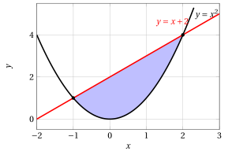

# Integration techniques and applications

**Part 7 · Integrals · Chapter 3** · [:material-file-pdf-box: Lecture notes, volume 7 (PDF)](../pdf/lecture-notes-7-integrals.pdf) · [:material-pencil-box-multiple: Exercises, volume 7 (PDF)](../pdf/exercises-7-integrals.pdf) · [:material-pencil: Exercises: Antiderivatives](../exercises/es-integrals-01-antiderivatives.md) · [:material-pencil: Exercises: Integrals](../exercises/es-integrals-02-integrals.md) · [:material-pencil: Exercises: Definite integrals, areas and mean value](../exercises/es-integrals-05-definite-integrals-areas.md) · [:material-presentation: Slides (PDF)](../pdf/slides-integrals-03-integration-techniques.pdf)

## 1. Integration by substitution

!!! teorema "Theorem 1: integration by substitution"

    Let $f$ be continuous on the interval $I$, let $F$ be an antiderivative of it and let $g: J \rr I$ be differentiable with continuous derivative on the interval $J$. Then

    $$
    i)~~~~ \int f\big(g(x)\big)\,g'(x)\,dx = F\big(g(x)\big) + c
    $$

    $$
    ii)~~~~ \int_a^b f\big(g(x)\big)\,g'(x)\,dx = \int_{g(a)}^{g(b)} f(t)\,dt, ~~~ \forall a, b \in J
    $$

??? dimostrazione "Proof"

    - <strong>$i)$</strong> By the chain rule $\big(F(g(x))\big)' = F'\big(g(x)\big)\,g'(x) = f\big(g(x)\big)\,g'(x)$: the function $F \circ g$ is an antiderivative of the integrand.

    - <strong>$ii)$</strong> The integrand on the left is continuous. By the fundamental formula of integral calculus and by $i)$ both sides equal $F\big(g(b)\big) - F\big(g(a)\big)$.

    
□

- In practice we set $t = g(x)$ and formally replace $dt = g'(x)\,dx$. In definite integrals the limits change too: $x = a$ becomes $t = g(a)$, $x = b$ becomes $t = g(b)$.

!!! esempio "Example 1: substitution"

    - $\displaystyle \int x\,e^{x^2}\,dx$: with $t = x^2$, $dt = 2x\,dx$, we get $\displaystyle \frac12 \int e^{t}\,dt = \frac12\,e^{x^2} + c$.

    - $\displaystyle \int \cos x\,\sin^3 x\,dx$: with $t = \sin x$, $dt = \cos x\,dx$, we get $\displaystyle \int t^3\,dt = \frac{\sin^4 x}{4} + c$.

    - $\displaystyle \int_0^1 x\sqrt{1+x^2}\,dx$: with $t = 1 + x^2$, $dt = 2x\,dx$, the limits become $t = 1$ and $t = 2$:

        $$
        \int_0^1 x\sqrt{1+x^2}\,dx = \frac12\int_1^2 \sqrt{t}\,dt = \frac12 \left[\frac{2}{3}\,t^{3/2}\right]_1^2 = \frac{2\sqrt2 - 1}{3}
        $$

!!! osservazione "Remark 1: change of variable"

    Formula $ii)$ is also used from right to left: to compute $\int_{\alpha}^{\beta} f(x)\,dx$ we set $x = \varphi(t)$, with $\varphi$ differentiable with continuous derivative and invertible, and

    $$
    \int_{\alpha}^{\beta} f(x)\,dx = \int_{\varphi^{-1}(\alpha)}^{\varphi^{-1}(\beta)} f\big(\varphi(t)\big)\,\varphi'(t)\,dt
    $$

    For an indefinite integral, at the end we go back to the variable $x$ with $t = \varphi^{-1}(x)$.

!!! esempio "Example 2: change of variable"

    - $\displaystyle \int \frac{\sqrt{x}}{1+x}\,dx$, for $x > 0$: with $x = t^2$, $t = \sqrt{x} > 0$, $dx = 2t\,dt$,

        $$
        \int \frac{2t^2}{1+t^2}\,dt = 2\int \left(1 - \frac{1}{1+t^2}\right) dt = 2t - 2\arctan t + c = 2\sqrt{x} - 2\arctan\sqrt{x} + c
        $$

    - $\displaystyle \int_0^1 \sqrt{1-x^2}\,dx$: with $x = \sin t$, $t \in \left[0, \frac{\pi}{2}\right]$, we have $dx = \cos t\,dt$ and $\sqrt{1 - \sin^2 t} = \cos t$ (because $\cos t \ge 0$). Using $\cos^2 t = \frac{1 + \cos 2t}{2}$,

        $$
        \int_0^1 \sqrt{1-x^2}\,dx = \int_0^{\pi/2} \cos^2 t\,dt = \left[\frac{t}{2} + \frac{\sin 2t}{4}\right]_0^{\pi/2} = \frac{\pi}{4}
        $$

        This is the area of a quarter of the circle of radius $1$.

## 2. Integration by parts

!!! teorema "Theorem 2: integration by parts"

    Let $f$ and $g$ be differentiable with continuous derivative on the interval $I$. Then

    $$
    i)~~~~ \int f(x)\,g'(x)\,dx = f(x)\,g(x) - \int f'(x)\,g(x)\,dx
    $$

    $$
    ii)~~~~ \int_a^b f(x)\,g'(x)\,dx = \big[ f(x)\,g(x) \big]_a^b - \int_a^b f'(x)\,g(x)\,dx, ~~~ \forall a, b \in I
    $$

??? dimostrazione "Proof"

    By the product rule $(f\,g)' = f'\,g + f\,g'$: the function $f\,g$ is an antiderivative of $f'\,g + f\,g'$. By the linearity of the indefinite integral

    $$
    f(x)\,g(x) + c = \int f'(x)\,g(x)\,dx + \int f(x)\,g'(x)\,dx
    $$

    which is $i)$. For $ii)$ we integrate $(f\,g)' = f'\,g + f\,g'$ between $a$ and $b$ with the fundamental formula of integral calculus and linearity. □

- $f$ is called the <strong>finite factor</strong> and $g'$ the <strong>differential factor</strong>. It is convenient to choose as $f$ the factor that becomes simpler when differentiated (a polynomial, a logarithm, an arctangent) and as $g'$ one whose antiderivative is known.

!!! esempio "Example 3: by parts"

    - $\displaystyle \int x\,e^{x}\,dx$: with $f = x$, $g' = e^x$, we get $\displaystyle x\,e^{x} - \int e^{x}\,dx = (x - 1)\,e^{x} + c$.

    - $\displaystyle \int \log x\,dx$, for $x > 0$: with $f = \log x$, $g' = 1$, we get $\displaystyle x\log x - \int x \cdot \frac{1}{x}\,dx = x\log x - x + c$.

    - $\displaystyle \int \arctan x\,dx$: with $f = \arctan x$, $g' = 1$, we get $\displaystyle x\arctan x - \int \frac{x}{1+x^2}\,dx = x\arctan x - \frac12\log(1+x^2) + c$.

    - $\displaystyle \int_0^{\pi} x\sin x\,dx$: with $f = x$, $g' = \sin x$,

        $$
        \int_0^{\pi} x\sin x\,dx = \big[-x\cos x\big]_0^{\pi} + \int_0^{\pi} \cos x\,dx = \pi + \big[\sin x\big]_0^{\pi} = \pi
        $$

!!! esempio "Example 4: an integral that comes back"

    Let $I = \int e^{x}\sin x\,dx$. Integrating by parts twice, with $g' = e^x$ both times,

    $$
    I = e^{x}\sin x - \int e^{x}\cos x\,dx = e^{x}\sin x - \left( e^{x}\cos x + \int e^{x}\sin x\,dx \right) = e^{x}(\sin x - \cos x) - I
    $$

    Solving the equation for $I$ (up to the constant):

    $$
    \int e^{x}\sin x\,dx = \frac{e^{x}\,(\sin x - \cos x)}{2} + c
    $$

## 3. Integration of rational functions

- We want to compute $\int \frac{P(x)}{Q(x)}\,dx$ with $P$ and $Q$ polynomials. If $\deg P \ge \deg Q$, we divide: $P = A\,Q + R$ with $\deg R < \deg Q$, and

    $$
    \frac{P(x)}{Q(x)} = A(x) + \frac{R(x)}{Q(x)}
    $$

    The polynomial $A$ is integrated at once; what remains is a <strong>proper</strong> rational function, with the degree of the numerator smaller than that of the denominator.

### 3.1 Denominator of first and second degree

- <strong>First degree</strong>: $\displaystyle \int \frac{1}{x - x_1}\,dx = \log|x - x_1| + c$.

- <strong>Second degree</strong>, $Q(x) = x^2 + px + q$ with discriminant $\Delta = p^2 - 4q$:

    - $\Delta > 0$: $Q(x) = (x - x_1)(x - x_2)$ and we look for $A$, $B$ with $\displaystyle \frac{R(x)}{Q(x)} = \frac{A}{x - x_1} + \frac{B}{x - x_2}$;

    - $\Delta = 0$: $Q(x) = (x - x_1)^2$ and $\displaystyle \frac{R(x)}{Q(x)} = \frac{A}{x - x_1} + \frac{B}{(x - x_1)^2}$, with $\displaystyle \int \frac{dx}{(x - x_1)^2} = -\frac{1}{x - x_1} + c$;

    - $\Delta < 0$: we complete the square, $Q(x) = \left(x + \frac{p}{2}\right)^2 + k^2$ with $k^2 = -\frac{\Delta}{4}$, and write the numerator as a multiple of $Q'(x) = 2x + p$ plus a constant.

- In the case $\Delta < 0$ we need the two antiderivatives

    $$
    \int \frac{2x + p}{x^2 + px + q}\,dx = \log(x^2 + px + q) + c, ~~~~~ \int \frac{dx}{(x + p/2)^2 + k^2} = \frac{1}{k}\arctan\frac{x + p/2}{k} + c
    $$

!!! osservazione "Remark 2: partial fraction decomposition"

    One can prove that every real polynomial $Q$ is the product of a constant, of first-degree factors $(x - a)$ and of second-degree factors $x^2 + px + q$ with $\Delta < 0$, possibly repeated. A proper rational function $\frac{R}{Q}$ is the sum of <strong>partial fractions</strong>: for every factor $(x - a)^m$ the terms $\frac{A_1}{x-a} + \dots + \frac{A_m}{(x-a)^m}$, for every (non-repeated) factor $x^2 + px + q$ one term $\frac{Mx + N}{x^2 + px + q}$. The constants are found by equating the numerators.

!!! esempio "Example 5: rational functions"

    - <strong>Division.</strong> $x^3 + x + 1 = x\,(x^2 + 1) + 1$, hence $\displaystyle \int \frac{x^3 + x + 1}{x^2 + 1}\,dx = \int \left(x + \frac{1}{x^2+1}\right) dx = \frac{x^2}{2} + \arctan x + c$.

    - <strong>$\Delta > 0$.</strong> $\displaystyle \frac{1}{x^2 - 1} = \frac{A}{x - 1} + \frac{B}{x + 1}$ gives $1 = A(x+1) + B(x-1)$: with $x = 1$ and $x = -1$ we get $A = \frac12$, $B = -\frac12$, and

        $$
        \int \frac{dx}{x^2 - 1} = \frac12 \log\left|\frac{x-1}{x+1}\right| + c
        $$

    - <strong>$\Delta = 0$.</strong> $2x + 3 = 2(x+1) + 1$, hence $\displaystyle \int \frac{2x+3}{(x+1)^2}\,dx = \int \left(\frac{2}{x+1} + \frac{1}{(x+1)^2}\right) dx = 2\log|x+1| - \frac{1}{x+1} + c$.

    - <strong>$\Delta < 0$.</strong> $x^2 + 2x + 5 = (x+1)^2 + 4$ and $x + 3 = \frac12(2x + 2) + 2$, hence

        $$
        \int \frac{x+3}{x^2+2x+5}\,dx = \frac12\log(x^2 + 2x + 5) + \arctan\frac{x+1}{2} + c
        $$

!!! esempio "Example 6: a repeated factor and a definite integral"

    - $\displaystyle \frac{1}{x(x+1)^2} = \frac{A}{x} + \frac{B}{x+1} + \frac{C}{(x+1)^2}$ gives $1 = A(x+1)^2 + Bx(x+1) + Cx$. With $x = 0$: $A = 1$; with $x = -1$: $C = -1$; comparing the coefficients of $x^2$: $A + B = 0$, that is, $B = -1$. Hence

        $$
        \int \frac{dx}{x(x+1)^2} = \log|x| - \log|x+1| + \frac{1}{x+1} + c
        $$

    - With the antiderivative of the previous example,

        $$
        \int_2^3 \frac{dx}{x^2-1} = \frac12\left[\log\frac{x-1}{x+1}\right]_2^3 = \frac12\left(\log\frac12 - \log\frac13\right) = \frac12\log\frac32
        $$

## 4. Areas of plane regions

!!! teorema "Proposition 1: area between two graphs"

    Let $f$ and $g$ be continuous on $[a,b]$ with $f(x) \le g(x)$ for every $x \in [a,b]$. The area of the region

    $$
    D = \big\{ (x,y) \in \R^2 : a \le x \le b, ~ f(x) \le y \le g(x) \big\}
    $$

    is

    $$
    {\rm Area}(D) = \int_a^b \big( g(x) - f(x) \big)\,dx
    $$

??? dimostrazione "Proof"

    By the Weierstrass theorem $f$ is bounded below: there is a constant $c$ with $f + c \ge 0$ on $[a,b]$. Shifting up by $c$ does not change the area, and the shifted region is the region under the graph of $g + c$ minus the region under the graph of $f + c$. By the geometric interpretation of the integral and by linearity

    $$
    {\rm Area}(D) = \int_a^b (g + c)\,dx - \int_a^b (f + c)\,dx = \int_a^b (g - f)\,dx
    $$

    
□

- The area of the region between the graph of $f$ and the $x$-axis is $\int_a^b |f(x)|\,dx$: we split $[a,b]$ into the intervals where $f$ has constant sign.

- If the two graphs cross, the area between them is $\int_a^b |g(x) - f(x)|\,dx$: first we look for the intersection points.

{ .fig .ovale loading=lazy style="width:65%" }

!!! esempio "Example 7: area between a parabola and a line"

    Let us compute the area of the region between $y = x^2$ and $y = x + 2$ (blue in the figure). The intersections come from $x^2 = x + 2$: $x = -1$ and $x = 2$. On $[-1, 2]$ the line lies above the parabola, hence

    $$
    {\rm Area} = \int_{-1}^{2} \big( x + 2 - x^2 \big)\,dx = \left[\frac{x^2}{2} + 2x - \frac{x^3}{3}\right]_{-1}^{2} = \frac{10}{3} - \left(-\frac{7}{6}\right) = \frac{9}{2}
    $$

!!! esempio "Example 8: graphs that cross"

    Let us compute the area between $y = \sin x$ and $y = \cos x$ for $x \in \left[0, \frac{\pi}{2}\right]$. The graphs cross at $x = \frac{\pi}{4}$: first the cosine lies above, then the sine. Hence

    $$
    {\rm Area} = \int_0^{\pi/4} (\cos x - \sin x)\,dx + \int_{\pi/4}^{\pi/2} (\sin x - \cos x)\,dx
    $$

    $$
    = \big[\sin x + \cos x\big]_0^{\pi/4} + \big[-\cos x - \sin x\big]_{\pi/4}^{\pi/2} = (\sqrt2 - 1) + (\sqrt2 - 1) = 2\sqrt2 - 2
    $$

!!! esempio "Example 9: area under the logarithm"

    On $[1, e]$ we have $\log x \ge 0$. With the antiderivative found by parts,

    $$
    {\rm Area} = \int_1^{e} \log x\,dx = \big[x\log x - x\big]_1^{e} = (e - e) - (0 - 1) = 1
    $$

## 5. Mean value of a function

- The mean value of $f$ on $[a,b]$ is the integral mean $\frac{1}{b-a}\int_a^b f(x)\,dx$: now we can compute it with an antiderivative.

- It is the natural extension of the arithmetic mean $\frac1n \sum_{k=1}^n f(x_k)$: with the uniform partition, $\frac1n\sum_{k=1}^n f(x_k) = \frac{1}{b-a}\sum_{k=1}^n f(x_k)\,\frac{b-a}{n}$ is a Riemann sum divided by $b - a$.

!!! esempio "Example 10: mean values"

    - The mean value of $\sin x$ on $[0, \pi]$ is $\displaystyle \frac{1}{\pi}\int_0^{\pi} \sin x\,dx = \frac{2}{\pi} \approx 0.64$.

    - The mean value of $x^2$ on $[0, 3]$ is $\displaystyle \frac13\left[\frac{x^3}{3}\right]_0^3 = 3$; as the integral mean value theorem predicts, it is taken at $c = \sqrt3 \in [0,3]$.

    - If a point moves with velocity $v(t) = 3t^2$ (metres per second) for $t \in [0, 2]$, the distance covered is $\int_0^2 3t^2\,dt = 8$ metres and the mean velocity is $\frac{8}{2} = 4$ metres per second.

!!! chiave "In summary"

    - <strong>Substitution</strong>: $\int_a^b f(g(x))\,g'(x)\,dx = \int_{g(a)}^{g(b)} f(t)\,dt$; with $t = g(x)$ the integrand, the differential and the limits change. Read backwards it is the change of variable $x = \varphi(t)$.

    - <strong>By parts</strong>: $\int f\,g' = f\,g - \int f'\,g$; we differentiate the factor that becomes simpler. Sometimes the integral comes back and is found from an equation.

    - <strong>Rational functions</strong>: division if needed, then partial fractions according to the factors of the denominator; second-degree factors with $\Delta < 0$ give a logarithm and an arctangent.

    - The area between two graphs is $\int_a^b |g - f|$, after finding the intersections.

    - The mean value $\frac{1}{b-a}\int_a^b f$ extends the arithmetic mean: it is the mean velocity if $f$ is a velocity.

---

**Exercises on this chapter:** [:material-pencil: Antiderivatives](../exercises/es-integrals-01-antiderivatives.md) · [:material-pencil: Integrals](../exercises/es-integrals-02-integrals.md) · [:material-pencil: Definite integrals, areas and mean value](../exercises/es-integrals-05-definite-integrals-areas.md)

