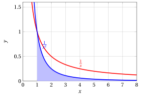
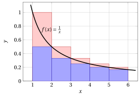

# Improper integrals

**Part 7 · Integrals · Chapter 4** · [:material-file-pdf-box: Lecture notes, volume 7 (PDF)](../pdf/lecture-notes-7-integrals.pdf) · [:material-pencil-box-multiple: Exercises, volume 7 (PDF)](../pdf/exercises-7-integrals.pdf) · [:material-pencil: Exercises: Integrals](../exercises/es-integrals-02-integrals.md) · [:material-pencil: Exercises: Improper integrals](../exercises/es-integrals-06-improper-integrals.md) · [:material-presentation: Slides (PDF)](../pdf/slides-integrals-04-improper-integrals.pdf)

## 1. Integrals on unbounded intervals

!!! definizione "Definition 1: improper integral on an unbounded interval"

    Let $f$ be continuous on $[a, \ip)$. The <strong>improper integral</strong> of $f$ on $[a,\ip)$ is the limit

    $$
    \int_a^{\ip} f(x)\,dx = \lim_{\omega \rr \ip} \int_a^{\omega} f(x)\,dx
    $$

    If the limit is finite the integral is called <strong>convergent</strong>, if it is $\ip$ or $\im$ it is called <strong>divergent</strong>; if the limit does not exist the integral <strong>does not exist</strong>.

- In the same way $\int_{\im}^{b} f(x)\,dx = \lim_{\omega \rr \im} \int_{\omega}^{b} f(x)\,dx$ for $f$ continuous on $(\im, b]$.

- For $f$ continuous on $\R$ we fix $c \in \R$ and set $\int_{\im}^{\ip} f = \int_{\im}^{c} f + \int_{c}^{\ip} f$: the integral converges if <strong>both</strong> integrals converge, and the value does not depend on $c$.

- If $\int_a^{\ip} f$ converges we also say that $f$ is <strong>integrable in the improper sense</strong> on $[a,\ip)$.

!!! esempio "Example 1: improper integrals on unbounded intervals"

    - $\displaystyle \int_0^{\ip} e^{-x}\,dx = \lim_{\omega \rr \ip} \big[-e^{-x}\big]_0^{\omega} = \lim_{\omega \rr \ip} \left(1 - e^{-\omega}\right) = 1$: it converges.

    - $\displaystyle \int_0^{\ip} \cos x\,dx$: $\int_0^{\omega} \cos x\,dx = \sin\omega$ has no limit as $\omega \rr \ip$, so the integral does not exist.

    - $\displaystyle \int_{\im}^{\ip} \frac{dx}{1+x^2} = \lim_{\omega \rr \im} \big[\arctan x\big]_{\omega}^{0} + \lim_{\omega \rr \ip} \big[\arctan x\big]_0^{\omega} = \frac{\pi}{2} + \frac{\pi}{2} = \pi$.

!!! teorema "Theorem 1: standard improper integral at infinity"

    Let $p \in \R$. The integral $\displaystyle \int_1^{\ip} \frac{dx}{x^p}$ converges if and only if $p > 1$, and in that case

    $$
    \int_1^{\ip} \frac{dx}{x^p} = \frac{1}{p-1}
    $$

    For $p \le 1$ it diverges to $\ip$.

??? dimostrazione "Proof"

    - For $p \neq 1$:

        $$
        \int_1^{\omega} \frac{dx}{x^p} = \left[\frac{x^{1-p}}{1-p}\right]_1^{\omega} = \frac{\omega^{1-p} - 1}{1 - p}
        $$

        If $p > 1$, the exponent $1 - p$ is negative and $\omega^{1-p} \rr 0$: the limit is $\frac{-1}{1-p} = \frac{1}{p-1}$. If $p < 1$, $\omega^{1-p} \rr \ip$ and the integral diverges.

    - For $p = 1$: $\int_1^{\omega} \frac{dx}{x} = \log\omega \rr \ip$.

    
□

{ .fig .ovale loading=lazy style="width:65%" }

- In the figure the blue area under $\frac{1}{x^2}$ on $[1, \ip)$ is finite and equals $1$, while the area under $\frac1x$ is infinite: the two graphs look alike, but $\frac{1}{x^2}$ tends to zero fast enough.

## 2. Integrals of unbounded functions

!!! definizione "Definition 2: improper integral of an unbounded function"

    Let $f$ be continuous on $(a, b]$. The <strong>improper integral</strong> of $f$ on $(a,b]$ is the limit

    $$
    \int_a^{b} f(x)\,dx = \lim_{\varepsilon \rr 0^+} \int_{a+\varepsilon}^{b} f(x)\,dx
    $$

    with the same terminology: convergent, divergent, does not exist.

- The interesting case is when $f$ is unbounded near $a$ (if $f$ has a continuous extension at $a$, the limit is the Riemann integral of the extension).

- In the same way, for $f$ continuous on $[a, b)$ we set $\int_a^b f = \lim_{\varepsilon \rr 0^+} \int_a^{b - \varepsilon} f$. If there are several critical points (both endpoints, an interior point, an infinite endpoint) we split the interval: the integral converges if all the pieces converge.

!!! teorema "Theorem 2: standard improper integral at zero"

    Let $p \in \R$. The integral $\displaystyle \int_0^{1} \frac{dx}{x^p}$ converges if and only if $p < 1$, and in that case

    $$
    \int_0^{1} \frac{dx}{x^p} = \frac{1}{1-p}
    $$

    For $p \ge 1$ it diverges to $\ip$.

??? dimostrazione "Proof"

    - For $p \neq 1$:

        $$
        \int_{\varepsilon}^{1} \frac{dx}{x^p} = \frac{1 - \varepsilon^{1-p}}{1 - p}
        $$

        If $p < 1$, $\varepsilon^{1-p} \rr 0$ as $\varepsilon \rr 0^+$ and the limit is $\frac{1}{1-p}$. If $p > 1$, $\varepsilon^{1-p} \rr \ip$ and the integral diverges.

    - For $p = 1$: $\int_{\varepsilon}^{1} \frac{dx}{x} = -\log\varepsilon \rr \ip$.

    
□

- The two standard integrals behave in opposite ways: at infinity we need $p > 1$, at zero we need $p < 1$. With the change of variable $t = x - a$ we see that $\int_a^b \frac{dx}{(x-a)^p}$ converges if and only if $p < 1$.

!!! esempio "Example 2: integrals of unbounded functions"

    - $\displaystyle \int_0^1 \frac{dx}{\sqrt{x}} = \frac{1}{1 - \frac12} = 2$ (theorem on the standard improper integral at zero with $p = \frac12$).

    - $\displaystyle \int_0^1 \log x\,dx = \lim_{\varepsilon \rr 0^+} \big[x\log x - x\big]_{\varepsilon}^{1} = -1 - \lim_{\varepsilon \rr 0^+} (\varepsilon\log\varepsilon - \varepsilon) = -1$, because $\varepsilon\log\varepsilon \rr 0$.

    - $\displaystyle \int_0^{1/2} \frac{dx}{x\log^2 x}$: with $t = \log x$ an antiderivative is $-\frac{1}{\log x}$, hence

        $$
        \int_0^{1/2} \frac{dx}{x\log^2 x} = \lim_{\varepsilon \rr 0^+} \left( -\frac{1}{\log\frac12} + \frac{1}{\log\varepsilon} \right) = \frac{1}{\log 2}
        $$

!!! attenzione ""

    Beware of points where the function is unbounded <strong>inside</strong> the interval. The computation $\int_{-1}^{1} \frac{dx}{x^2} = \left[-\frac1x\right]_{-1}^{1} = -2$ is wrong: the integrand is positive and it is not defined at $0$. Splitting at $0$, $\int_0^1 \frac{dx}{x^2}$ diverges (with $p = 2$), hence $\int_{-1}^{1} \frac{dx}{x^2} = \ip$.

## 3. Convergence tests

- Often we do not need the value of an improper integral, only whether it converges, even when an antiderivative cannot be written. As for series, for non-negative functions there are comparison tests.

!!! osservazione "Remark 1: non-negative functions"

    If $f$ is continuous and non-negative on $[a, \ip)$, the function $\omega \mapsto \int_a^{\omega} f(x)\,dx$ is non-decreasing. By the monotonicity theorem for functions its limit as $\omega \rr \ip$ exists: the integral <strong>either converges or diverges to $\ip$</strong>, and it converges if and only if $\int_a^{\omega} f$ is bounded.

!!! teorema "Theorem 3: comparison test for improper integrals"

    Let $f$ and $g$ be continuous on $[a, \ip)$ with $0 \le f(x) \le g(x)$ for every $x \ge a$. Then:

    $$
    i)~~~~ \int_a^{\ip} g(x)\,dx {\rm ~~convergent~} ~~\Rightarrow~~ \int_a^{\ip} f(x)\,dx {\rm ~~convergent}
    $$

    $$
    ii)~~~~ \int_a^{\ip} f(x)\,dx {\rm ~~divergent~} ~~\Rightarrow~~ \int_a^{\ip} g(x)\,dx {\rm ~~divergent}
    $$

??? dimostrazione "Proof"

    By the monotonicity of the integral, for every $\omega \ge a$

    $$
    \int_a^{\omega} f(x)\,dx \le \int_a^{\omega} g(x)\,dx \le \int_a^{\ip} g(x)\,dx
    $$

    where the last inequality holds because the integral function of $g \ge 0$ is non-decreasing. If $\int_a^{\ip} g$ converges, $\int_a^{\omega} f$ is bounded and by the Remark on non-negative functions $\int_a^{\ip} f$ converges: this is $i)$. Statement $ii)$ is the contrapositive of $i)$, because both integrals either converge or diverge to $\ip$. □

!!! teorema "Theorem 4: limit comparison test for improper integrals"

    Let $f$ and $g$ be continuous and positive on $[a, \ip)$ and let

    $$
    \lim_{x \rr \ip} \frac{f(x)}{g(x)} = \ell {\rm ~~~~with~~~~} 0 < \ell < \ip
    $$

    (in particular if $f(x) \sim g(x)$ as $x \rr \ip$). Then $\int_a^{\ip} f(x)\,dx$ and $\int_a^{\ip} g(x)\,dx$ are both convergent or both divergent.

??? dimostrazione "Proof"

    By the definition of limit with $\varepsilon = \frac{\ell}{2}$, there exists $x_1 \ge a$ such that

    $$
    \frac{\ell}{2} \le \frac{f(x)}{g(x)} \le \frac{3\ell}{2} ~~~\Longrightarrow~~~ \frac{\ell}{2}\,g(x) \le f(x) \le \frac{3\ell}{2}\,g(x), ~~~ \forall x \ge x_1
    $$

    By the comparison test applied on $[x_1, \ip)$: if $\int g$ converges, $\int f$ converges (second inequality); if $\int g$ diverges, $\int f$ diverges (first inequality). Finally $\int_a^{x_1} f$ and $\int_a^{x_1} g$ are integrals of continuous functions on a closed and bounded interval, hence finite: they do not change the behaviour. □

- If the limit is $\ell = 0$ only one implication holds: if $\int_a^{\ip} g$ converges, then $\int_a^{\ip} f$ converges too (because eventually $f \le g$).

- The same tests hold for unbounded functions on $(a,b]$, with the limits as $x \rr a^+$; the typical comparison is with $\frac{1}{(x-a)^p}$.

!!! esempio "Example 3: limit comparison at infinity"

    - $\displaystyle \int_1^{\ip} \frac{x+1}{x^3+2}\,dx$: as $x \rr \ip$, $\frac{x+1}{x^3+2} \sim \frac{1}{x^2}$, and $\int_1^{\ip} \frac{dx}{x^2}$ converges: the integral converges.

    - $\displaystyle \int_1^{\ip} \frac{dx}{\sqrt{x^2 + x}}$: as $x \rr \ip$, $\frac{1}{\sqrt{x^2+x}} \sim \frac{1}{x}$: the integral diverges.

    - $\displaystyle \int_0^{\ip} e^{-x^2}\,dx$: for $x \ge 1$ we have $x^2 \ge x$ and hence $0 < e^{-x^2} \le e^{-x}$; since $\int_1^{\ip} e^{-x}\,dx$ converges, by comparison $\int_1^{\ip} e^{-x^2}\,dx$ converges, and $\int_0^1 e^{-x^2}\,dx$ is finite: the integral converges.

!!! esempio "Example 4: limit comparison at zero"

    - $\displaystyle \int_0^{1} \frac{\sin x}{x^{3/2}}\,dx$: as $x \rr 0^+$, $\sin x \sim x$ and $\frac{\sin x}{x^{3/2}} \sim \frac{1}{x^{1/2}}$; since $\frac12 < 1$, the integral converges.

    - $\displaystyle \int_0^{1} \frac{dx}{e^x - 1}$: as $x \rr 0^+$, $e^x - 1 \sim x$ and $\frac{1}{e^x - 1} \sim \frac1x$: the integral diverges.

!!! esempio "Example 5: an integral with a parameter"

    For which $\alpha \in \R$ does $\displaystyle \int_0^{\ip} \frac{x^{\alpha}}{1+x^2}\,dx$ converge? The integrand is continuous and positive on $(0, \ip)$; we split at $x = 1$.

    - On $(0,1]$: $\frac{x^{\alpha}}{1+x^2} \sim x^{\alpha} = \frac{1}{x^{-\alpha}}$ as $x \rr 0^+$; it converges if and only if $-\alpha < 1$, that is, $\alpha > -1$.

    - On $[1,\ip)$: $\frac{x^{\alpha}}{1+x^2} \sim \frac{1}{x^{2-\alpha}}$ as $x \rr \ip$; it converges if and only if $2 - \alpha > 1$, that is, $\alpha < 1$.

    The integral converges if and only if $-1 < \alpha < 1$.

!!! teorema "Theorem 5: absolute convergence for improper integrals"

    Let $f$ be continuous on $[a, \ip)$. If $\int_a^{\ip} |f(x)|\,dx$ converges, then $\int_a^{\ip} f(x)\,dx$ converges too and

    $$
    \left| \int_a^{\ip} f(x)\,dx \right| \le \int_a^{\ip} |f(x)|\,dx
    $$

??? dimostrazione "Proof"

    We have $0 \le f(x) + |f(x)| \le 2\,|f(x)|$. By the comparison test $\int_a^{\ip} \big(f + |f|\big)$ converges. Then

    $$
    \int_a^{\omega} f(x)\,dx = \int_a^{\omega} \big(f(x) + |f(x)|\big)\,dx - \int_a^{\omega} |f(x)|\,dx
    $$

    converges as well, because both terms have a finite limit as $\omega \rr \ip$. The inequality follows by taking the limit in $\left|\int_a^{\omega} f\right| \le \int_a^{\omega} |f|$. □

!!! esempio "Example 6: absolute convergence"

    The integrand of $\displaystyle \int_1^{\ip} \frac{\sin x}{x^2}\,dx$ changes sign infinitely many times, so the comparison tests do not apply directly. But $\left|\frac{\sin x}{x^2}\right| \le \frac{1}{x^2}$ and $\int_1^{\ip} \frac{dx}{x^2}$ converges: the integral converges absolutely, hence it converges.

## 4. Integral test for series

!!! teorema "Theorem 6: integral test"

    Let $f: [1, \ip) \rr \R$ be continuous, non-negative and non-increasing. Then the series $\sum_{k=1}^{\infty} f(k)$ and the integral $\int_1^{\ip} f(x)\,dx$ are both convergent or both divergent. Moreover, for every $n \ge 2$,

    $$
    \sum_{k=2}^{n} f(k) \le \int_1^{n} f(x)\,dx \le \sum_{k=1}^{n-1} f(k)
    $$

??? dimostrazione "Proof"

    For $x \in [k, k+1]$, since $f$ is non-increasing, $f(k+1) \le f(x) \le f(k)$. By the Corollary on the estimates of the integral

    $$
    f(k+1) \le \int_k^{k+1} f(x)\,dx \le f(k)
    $$

    Summing over $k \in \{1, 2, \dots, n-1\}$ and using additivity we get the inequalities of the statement.

    - If the integral converges, the partial sums $\sum_{k=1}^{n} f(k) \le f(1) + \int_1^{\ip} f$ are bounded: the series, with non-negative terms, converges.

    - If the series converges, $\int_1^{n} f \le \sum_{k=1}^{\infty} f(k)$ for every $n$; since $\omega \mapsto \int_1^{\omega} f$ is non-decreasing, it is bounded and the integral converges by the Remark on non-negative functions.

    
□

{ .fig .ovale loading=lazy style="width:65%" }

- In the figure, with $f(x) = \frac1x$: the blue rectangles (heights $f(2), f(3), \dots$) lie below the graph, the red ones (heights $f(1), f(2), \dots$) above. The series and the integral differ at most by the first term.

- The test also applies starting from an integer $k_0$ other than $1$: we compare $\sum_{k=k_0}^{\infty} f(k)$ and $\int_{k_0}^{\ip} f$.

!!! esempio "Example 7: series and integrals"

    - <strong>Generalized harmonic series.</strong> For $p > 0$ the function $\frac{1}{x^p}$ is positive and decreasing: by the theorem on the standard improper integral at infinity, $\sum_{k=1}^{\infty} \frac{1}{k^p}$ converges if and only if $p > 1$ (for $p \le 0$ the general term does not tend to $0$). We recover the behaviour of the generalized harmonic series.

    - $\displaystyle \sum_{k=2}^{\infty} \frac{1}{k\log k}$ diverges: with $t = \log x$, $\int_2^{\omega} \frac{dx}{x\log x} = \log(\log\omega) - \log(\log 2) \rr \ip$.

    - $\displaystyle \sum_{k=2}^{\infty} \frac{1}{k\log^2 k}$ converges: $\int_2^{\omega} \frac{dx}{x\log^2 x} = \frac{1}{\log 2} - \frac{1}{\log\omega} \rr \frac{1}{\log 2}$.

!!! esempio "Example 8: how fast the harmonic series grows"

    With $f(x) = \frac1x$ the inequalities of the integral test give, for $n \ge 2$,

    $$
    \sum_{k=2}^{n} \frac1k \le \log n {\rm ~~~~and~~~~} \log(n+1) = \int_1^{n+1} \frac{dx}{x} \le \sum_{k=1}^{n} \frac1k
    $$

    that is

    $$
    \log(n+1) \le 1 + \frac12 + \dots + \frac1n \le 1 + \log n
    $$

    The partial sums of the harmonic series grow like $\log n$: to exceed $10$ more than $8000$ terms are needed, because $1 + \log n < 10$ as long as $n < e^9 \approx 8103$.

!!! chiave "In summary"

    - An improper integral is a limit of Riemann integrals: $\int_a^{\ip} f = \lim_{\omega \rr \ip} \int_a^{\omega} f$, $\int_a^b f = \lim_{\varepsilon \rr 0^+} \int_{a+\varepsilon}^b f$ if $f$ is unbounded near $a$. With several critical points we split the interval.

    - $\int_1^{\ip} \frac{dx}{x^p}$ converges if and only if $p > 1$; $\int_0^1 \frac{dx}{x^p}$ converges if and only if $p < 1$.

    - For non-negative functions the integral converges or diverges to $\ip$; the comparison test and the limit comparison test hold (with $f \sim g$ same behaviour).

    - If $\int |f|$ converges, then $\int f$ converges too (absolute convergence).

    - For $f$ non-negative and non-increasing, $\sum f(k)$ and $\int_1^{\ip} f$ have the same behaviour (integral test).

---

**Exercises on this chapter:** [:material-pencil: Integrals](../exercises/es-integrals-02-integrals.md) · [:material-pencil: Improper integrals](../exercises/es-integrals-06-improper-integrals.md)

